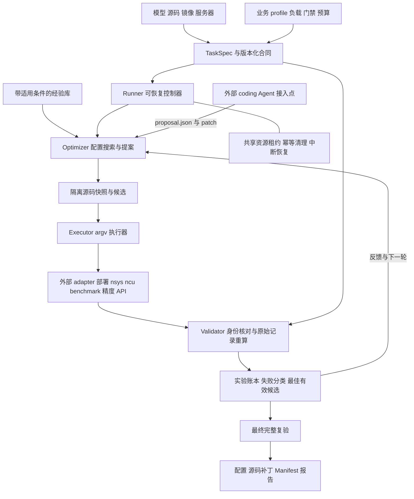

<p align="center">
  
</p>

# KSEO

**Kernel, Scheduling & End-to-End Optimizer**

内核、调度与端到端推理优化引擎。

KSEO 将模型优化任务书、执行脚本和历史经验组织为可恢复的实验闭环：冻结任务合同，建立基线，根据结果提出配置或源码候选，再由独立 Validator 检查正确性和端到端表现。

当前版本提供 Python CLI、配置搜索、外部 coding Agent 提案接口、隔离源码补丁、逐请求验收、经验检索、资源锁、恢复和交付包。真实模型通过自己的 adapter 接入现有部署、profiling、精度和 API 脚本；内置 CPU 示例明确标记为 `synthetic`，不代表 GPU 性能收益。

## Architecture




详见 [Architecture 与边界](docs/architecture.md)。

## 快速开始

要求 Linux、Python 3.10 及以上和 Git。运行时不依赖第三方 Python 包。

```bash
python3 -m pip install -e .

# 参数搜索，全部为 CPU synthetic 数据，不启动模型
kseo demo --run-dir ./runs/demo-grid

# 提案协议与源码补丁示例，使用确定性提案器演示，不调用 LLM
kseo demo --agent --run-dir ./runs/demo-agent

kseo status ./runs/demo-agent
```

两个示例请依次运行，它们共用演示资源锁。配置搜索会拒绝 TTFT 较低但 TPOT 超限的候选；Agent 协议示例还会修改独立源码副本，并导出相对基线的累积补丁。

查看结果：

```text
runs/demo-agent/
├── task.json                 冻结合同
├── tools_manifest.json       执行工具与本地负载身份
├── source-base/              历史源码的独立只读起点
├── state.json                状态和最佳候选
├── events.jsonl              追加事件日志
├── proposals/                Agent 请求和提案
├── trials/                   每次源码、原始结果、门禁和日志
├── bundle/                   最佳配置、源码补丁和 Manifest
└── report.md                 中文状态报告
```

## 接入真实模型

先建立一个业务 profile，固定负载、thinking、warmup、缓存政策、验收规则和预算。此后可以用模型、源码、镜像和服务器信息生成任务：

```bash
kseo init \
  --model /path/to/model \
  --source /path/to/vllm \
  --image registry.example.com/vllm@sha256:YOUR_IMAGE_DIGEST \
  --server gpu-host \
  --profile /path/to/your-profile.json \
  --out task.json

kseo validate task.json
kseo run task.json --run-dir ./runs/model-001
```

不提供 `--profile` 时会生成 A800 长上下文任务草稿。草稿含明确占位符，必须补齐实际 adapter、GPU UUID、模型与负载身份及门禁，设置 `draft=false` 后才能运行。示例阈值不是新模型的默认质量承诺。

真实平台操作由 adapter 完成，KSEO 不会仅凭四类输入自动猜测 AIHub、SSH/Docker 或模型架构细节。可直接包装已有脚本，见 [adapter 接入](docs/adapters.md) 和 [任务合同](docs/task-contract.md)。

## Agent 与源码优化

`optimizer.kind=grid` 提供有限配置搜索。`optimizer.kind=agent` 调用用户配置的命令，将合同、历史、当前源码位置和匹配经验写入 `request.json`，读取 `proposal.json` 及可选 `patch.diff`。

外部 Agent 负责分析和提出假设。KSEO 负责限制参数空间、在独立 Git 副本应用补丁、执行验证和维护最佳有效候选。每次修改都要通过完整门禁；候选不能修改合同或 Validator。KSEO 本身不是 OS sandbox，外部 Agent 的文件和命令权限应由调用它的环境控制。

参见 [Agent 工作流和提案协议](docs/agent-workflow.md)。

## 恢复与重新验收

```bash
kseo resume ./runs/model-001
kseo validate ./runs/model-001/task.json \
  --trial-dir ./runs/model-001/trials/t0001
```

恢复时先终止身份匹配的本地残留子进程，再调用幂等 cleanup adapter 清理本任务的远端资源。清理失败会保留资源租约，阻止其他 run 复用同一资源。候选的部署失败和执行失败可在有限次数内重试，不作为有效性能负分；中断实验会保留并重新执行。

跨机器或不同运行入口必须配置同一个共享 `resources.lock_dir`，并使用一致的物理 GPU UUID 标识。默认锁目录位于 run 的父目录，仅保护使用该目录的控制器。

## 经验转换

工程内置 9 张经过脱敏的历史经验卡，保留成功、失败、无效测量、部署失败和待验证假设的差别。模型特定规则只有在结构、硬件和能力条件匹配时才进入检索。

```bash
kseo knowledge --context your-context.json
kseo ingest /path/to/task.md /path/to/acceptance.json --out imported.json
```

`ingest` 建立 `NEEDS_REVIEW` 卡片，做基础脱敏，不会把历史 PASS 自动当作新任务成功。补齐适用条件、来源和迁移限制并审查后，才能接入自动检索。见 [任务书与经验转换](docs/conversion.md)。

## 验证

```bash
PYTHONPATH=src python3 -m unittest discover -s tests -v
```

测试覆盖原始请求重算、配置与身份不一致、缓存污染、精度计分、源码隔离、硬门禁、资源冲突、失败清理和恢复。CI 在 Python 3.10 和 3.12 上执行测试及两个 CPU 示例。

首版已完成的本地检查见 [验证记录](docs/validation.md)。

## 当前边界

- 已实现通用执行闭环及协议；AIHub、SSH/Docker 和模型特定操作由 adapter 接入。
- 已实现网格搜索与外部 Agent 接口；当前没有内置 LLM 服务凭据或厂商 SDK。
- 最终复验在新的 trial 中运行相同完整合同；独立测试集、冷启动和最终镜像验证需由实际 profile 与 adapter 明确实现。
- `bundle/` 输出本地源码与配置交付包。容器镜像构建、签名、发布和实际 runtime 核验由 build/deploy adapter 负责，KSEO 不会假装已生成或验收真实镜像。
- 性能测量依据 adapter 提供的原始记录。可信 adapter、计时语义和外部 Agent 的运行隔离仍是实验可信度的前提。

[LOGO 说明与生成 prompt](assets/LOGO.md)
