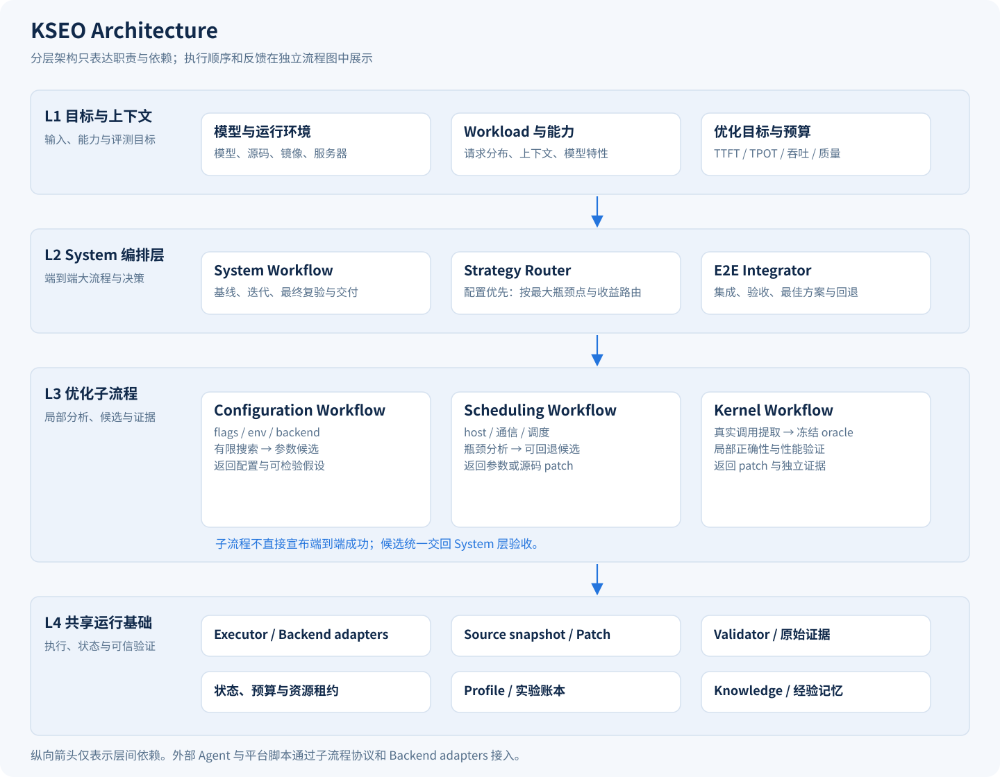
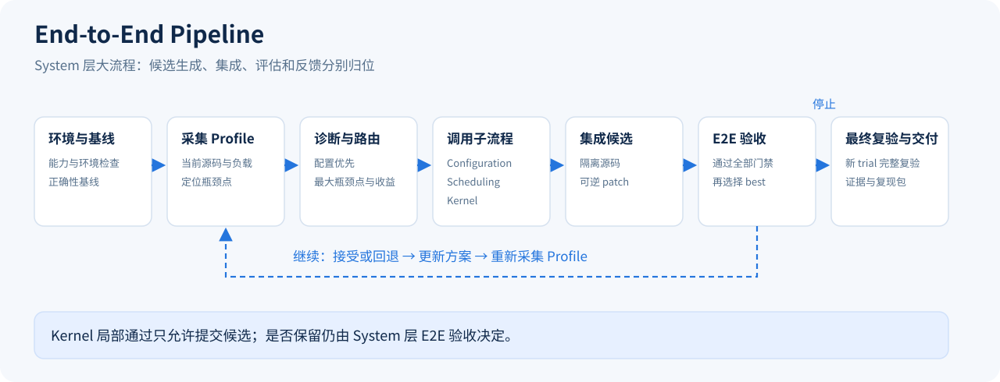

<p align="center">
  
</p>

# KSEO

**Kernel, Scheduling & End-to-End Optimizer**

内核、调度与端到端推理优化引擎。

KSEO 参考 GEAK 的 System 与 Kernel 分层设计，组织端到端推理优化流水线：建立基线、采集 Profile、诊断与路由、调用优化子流程、集成候选、端到端验收，再根据结果继续迭代或交付。

优化能力分为 **Configuration、Scheduling、Kernel** 三个子流程。共享 Runner 提供执行、状态和资源能力；System 层负责端到端选择。任务书、历史实验、社区知识和 profiling 都是输入来源，工作流按优化职责划分。

当前提供标准化瓶颈与 Amdahl 排序、配置优先搜索、Scheduling 提案、独立 Kernel oracle 与局部验证、可逆集成、E2E 门禁、恢复和交付包。

优化真实模型时，你需要提供模型路径、基础源码、基础镜像、可用服务器或集群、优化目标等信息。Agent 再根据这些信息准备环境、启动服务、分析性能、修改代码和运行测试。当前已提供优化流程和接入接口，实际执行脚本还需要由 Agent 根据具体平台接通。

示例 Prompt（模型、资源及目标数值按每次任务提供，以下示例约定 1K=1024）：

```text
使用KSEO完成GLM-5.3-Flash模型适配和推理优化。
- 基础材料：
  - KSEO仓库：http://192.168.70.8/zhanghong/kseo
  - 模型路径：/nfs/AE/zhanghong/ZhipuAI/GLM-5.3-Flash/
  - vLLM源码：https://github.com/Malav-P/vllm/tree/glm53flash-a100
  - 基础镜像：192.168.14.129:80/ae/vllm_openai_ssh:v0.26.0
- 相关约束：
  - 最大上下文固定为：256K，1k=1024。
  - 不限制总时间预算，精度测试不限时。
- 目标：
  - 单轮对话场景目标：72K输入256输出，1/2/3并发，TTFT/TPOT < 10s/30ms，thinking固定为high，GSM8K≥95%、RTLBench≥40%、LongBench≥59%、LiveCodeBench≥86%。
  - 单轮对话场景阶段目标：72K输入256输出，1/2/3并发，TTFT/TPOT，30s/50ms、20s/50ms、15s/40ms、12s/40ms、10s/40ms、10s/30ms。
  - 多轮对话场景目标：开启KVOffloading，TTFT至少下降30%。
  - 最终部署目标：保证正确性的情况下优化推理速度、测试模型精度、完成模型服务API验证、稳定性验证、实现一键部署。
  - 其余目标和约束使用KSEO默认要求。
- 硬件资源：
  - 可用的AIHub集群：655，单台八卡A800机器。
  - AIHub网址：http://192.168.11.18:30021/
  - AIHub使用文档：/nfs/AE/zhanghong/from_lixiao/aihub_docs.json
- 权限信息：
  - AIHub用户token：/nfs/AE/zhanghong/workflow/vllm_d/aihub_token.md
  - 本机用户密码：/nfs/AE/zhanghong/workflow/tmp_vllm_a/server_info.md，其中，Windows机器有访问外网的权限。
  - 任务执行过程中所有中间结果保存到：/nfs/AE/zhanghong/workflow/tmp_vllm_a/glm53_flash_v1/
  - GitLab权限：本机用户zhanghong具有GitLab权限。
```

仓库里的 CPU 示例使用模拟数据（`synthetic`），用于检查优化流程能否正常走通。这些示例的速度和收益不代表真实模型的优化结果。

## Architecture

分层架构只展示职责与依赖，层内不混入反馈回路。



## End-to-End Pipeline

System 层负责外部大流程。下图仅保留一条主线和一条位于主线下方的反馈回路。



Configuration、Scheduling 和 Kernel 的内部小流程单独展开，见 [Architecture 与子流程说明](docs/architecture.md)。

## 快速开始

要求 Linux、Python 3.10 及以上和 Git。运行时不依赖第三方 Python 包。

```bash
python3 -m pip install -e .

# 推荐：运行分层流水线，全部为 CPU synthetic 数据，不启动模型
kseo demo --pipeline --run-dir ./runs/demo-pipeline

# 独立配置搜索接口
kseo demo --run-dir ./runs/demo-grid

# 提案协议与源码补丁示例，使用确定性提案器演示，不调用 LLM
kseo demo --agent --run-dir ./runs/demo-agent

kseo status ./runs/demo-agent
```

示例请依次运行，它们共用演示资源锁。pipeline 示例依次演示配置搜索、热点变化、Scheduling 修改、Kernel oracle 提取与冻结、独立局部验证、集成和最终 E2E 复验。其他两个示例保留为基础接口演示。

查看结果：

```text
runs/demo-pipeline/
├── task.json                 冻结合同
├── tools_manifest.json       执行工具与本地负载身份
├── source-base/              历史源码的独立只读起点
├── state.json                状态和最佳候选
├── events.jsonl              追加事件日志
├── proposals/                基础 Agent 请求和提案
├── workflows/                子流程请求、oracle、局部验证和候选
├── workflow-tree.json        System 与内部阶段的对应关系
├── learned-experience.json   本次运行形成的带来源经验
├── trials/                   每次源码、原始结果、门禁和日志
├── bundle/                   最佳配置、源码补丁和 Manifest
└── report.md                 中文状态报告
```

## 接入真实模型

面向每次不同模型的简要输入，优先使用新的自举入口。模型、长度、并发、Thinking、各项阈值和阶段目标都来自本次任务；统一默认只定义测量和执行语义。

```bash
kseo defaults
kseo prepare examples/brief/model-a.json --out ./runs/model-a-intake
# 外层 coding Agent 执行 bootstrap-request.json，生成实际 adapters 与冻结 task.json
kseo doctor /path/to/task.json --brief ./runs/model-a-intake/brief.json
```

输出总 token 默认包含 reasoning；多轮收益默认按含第一轮的整体平均 TTFT 下降 ≥30%；精度不加人工输出 cap；允许更新 Docker，同时核对候选镜像和最终新部署身份。`prepare` 不启动 GPU；`doctor` 是静态检查，实际运行仍由平台 Backend 和模型 adapters 完成。详见 [新模型自举与默认口径](docs/agent-bootstrap.md)。

先建立一个业务 profile，固定负载、thinking、warmup、缓存政策、验收规则和预算。此后可以用模型、源码、镜像和服务器信息生成任务：

```bash
kseo init \
  --model /path/to/model \
  --source /path/to/vllm \
  --image registry.example.com/vllm@sha256:YOUR_IMAGE_DIGEST \
  --server gpu-host \
  --profile /path/to/your-profile.json \
  --out task.json

kseo validate task.json
kseo run task.json --run-dir ./runs/model-001
```

不提供 `--profile` 时会生成 A800 长上下文任务草稿。草稿含明确占位符，必须补齐实际 adapter、GPU UUID、模型与负载身份及门禁，设置 `draft=false` 后才能运行。示例阈值不是新模型的默认质量承诺。

真实平台操作由 adapter 完成，KSEO 不会仅凭四类输入自动猜测 AIHub、SSH/Docker 或模型架构细节。可直接包装已有脚本，见 [adapter 接入](docs/adapters.md) 和 [任务合同](docs/task-contract.md)。

## Agent 与源码优化

角色分为 **瓶颈分析员、开发人员、验收人员**，由 System 调度。分析员提交绑定当前 Profile 的诊断，开发人员只提交参数与 patch，独立 Validator 从冻结合同和原始结果重算结论。角色可以使用同一个模型的独立会话；默认验收裁决为程序化 Validator。执行 `kseo roles` 查看协议，详见 [角色设计与权限](docs/roles.md)。

`optimizer.kind=pipeline` 使用分层流水线：先执行有独立预算的 Configuration sweep，再按当前 Profile 选择 Scheduling 或 Kernel。Kernel 子流程包含 extractor、proposer 和独立 validator，只有局部验证通过的 patch 才能进入 System 集成。

`grid` 和 `agent` 仍保留为基础调用模式；`agent` 读取 `request.json` 并返回 `proposal.json` 和可选 `patch.diff`。

外部 Agent 负责分析和提出假设。KSEO 负责限制参数空间、在独立 Git 副本应用补丁、执行验证和维护最佳有效候选。配置阶段目标时，搜索中的正确中间候选可保留，最终交付仍须通过完整目标与全部验收；候选不能修改合同或 Validator。KSEO 本身不是 OS sandbox，外部 Agent 的文件和命令权限应由调用它的环境控制。

参见 [Agent 工作流和提案协议](docs/agent-workflow.md)。

## 恢复与重新验收

```bash
kseo resume ./runs/model-001
kseo validate ./runs/model-001/task.json \
  --trial-dir ./runs/model-001/trials/t0001
```

恢复时先终止身份匹配的本地残留子进程，再调用幂等 cleanup adapter 清理本任务的远端资源。清理失败会保留资源租约，阻止其他 run 复用同一资源。候选的部署失败和执行失败可在有限次数内重试，不作为有效性能负分；中断实验会保留并重新执行。

跨机器或不同运行入口必须配置同一个共享 `resources.lock_dir`，并使用一致的物理 GPU UUID 标识。默认锁目录位于 run 的父目录，仅保护使用该目录的控制器。

## 经验转换

经验按 **原则 → 方法 → 场景规则 → 案例与来源** 由粗到细组织：6 条原则、13 个方法、68 条规则、59 个案例，关联 97 条来源记录。原有模型、跨模型、最终精度与全模型默认规则保持；新增 RSI 方法库的 M13 实验总则和17个带条件优化方向，覆盖资源/存活区间、分块、索引/元数据/地址、转换/访存、冗余消除、GPU 流水线、机器码回归和条件性模型生命周期复用。这批新增内容是优化思路与实验方向，没有新增 GPU 实测案例或性能承诺。

Agent 请求中的 `knowledge_hierarchy.optimization_methods` 提供完整方向导航，不挤占原有 top-k。按当前最大瓶颈点选择一两个有成本证据的动作，再下钻成立条件、最小改动、控制、预测与反证；不要求遍历所有方法。详见 [优化思路与方向](docs/optimization-methods.md)。

**全模型规则 G-P01：速度优化必须数学等价，只允许浮点自身引入的微小数值差异。** 不要求 bitwise 一致；容差须在搜索前按 dtype、算子和 shape 冻结。数值接近或质量分数通过不能单独证明数学等价，历史经验不能豁免该前提。

每一层都注明证据边界，案例保留历史观察和原状态。跨模型规则是需要当前任务验证的迁移建议；未闭环根因继续保留未闭环。详见 [分层知识手册](docs/knowledge.md) 与 [案例和来源索引](docs/knowledge-cases.md)。

```bash
kseo knowledge --tree
kseo knowledge --node G-P01
kseo knowledge --node K04
kseo knowledge --node R15
kseo knowledge --node case:R15
kseo knowledge --node M13
kseo knowledge --node RSI-15
kseo knowledge --hierarchy --context examples/knowledge/kernel-method-context.json
kseo knowledge --hierarchy --context examples/knowledge/glm52-pd-context.json --limit 24

# 原有平面检索和模型 recipe 接口继续可用
kseo knowledge --context your-context.json
kseo recipe deepseek-v4.1-flash --out ./v41-experience.json
kseo knowledge --context examples/knowledge/v41-context.json --limit 40
kseo ingest /path/to/task.md /path/to/acceptance.json --out imported.json
```

`ingest` 建立 `NEEDS_REVIEW` 卡片，做基础脱敏，不会把历史 PASS 自动当作新任务成功。补齐适用条件、来源和迁移限制并审查后，才能接入自动检索。见 [流程与经验迁移](docs/conversion.md)。

Agent 请求新增 `knowledge_hierarchy`，携带原则、所选方法、规则、匹配案例、祖先关系与来源。全模型 G-P01/G-P02/G-P03 始终提供，V4.1 的 `model_recipe` 仍完整提供 11 条模型现行规则，均不受 top-k 截断。2048-token 含义、并发增长阈值和计时口径中的未明确项均保留为待确认，不能自动判 PASS。详见 [V4.1-Flash 优化经验](docs/models/deepseek-v4.1-flash.md)。知识和经验包尚未替代真实部署、warmup 审计和 Feature 采集 adapter。

## 本地数据与最终精度

测试集按本地冻结版本验收，不替换为官方数据：**GSM8K 1319、RTLBench 160、LongBenchv2 525、LiveCodeBench 400**。正文、清单、SHA256 和许可来源说明随仓库及安装包提交；大文件采用无损 gzip 分片。LongBench 含 105 条不同内容各重复 5 次，保留原顺序和 525 分母，披露该边界，不去重。

```bash
kseo dataset
kseo dataset longbench-v2 --out ./data/longbench-v2
kseo dataset livecodebench-v1 --out ./data/livecodebench-v1
kseo knowledge --node G-P02
```

真实优化完成后，最终 trial 依次执行 **RTLBench → LongBenchv2 → LiveCodeBench**；三项得分、raw 和有效性均通过才可交付。GSM8K 可作为优化中的质量门禁，不能替代三项最终验收。0.4.0 的 measured 合同必须配置 `final_accuracy`，旧合同需补齐。真实 harness 通过 bridge 接入，当前未内置模型推理或代码执行沙箱。

见 [本地数据与导出](docs/datasets.md)、[最终精度合同与踩坑](docs/final-accuracy.md)。

## 验证

```bash
PYTHONPATH=src python3 -m unittest discover -s tests -v
```

测试覆盖原始请求重算、身份、缓存、精度、源码隔离、门禁、资源、恢复，以及分层路由、冻结 oracle 和局部通过但 E2E 回退。CI 在 Python 3.10 和 3.12 上执行测试及三个 CPU 示例。

本地检查与版本演进见 [验证记录](docs/validation.md)。

## 当前边界

- 已实现 System 与三个优化子流程；实际 GPU 采样、Kernel 提取、平台部署及模型特定操作由 adapter 接入。
- Configuration 使用有限网格搜索；可选瓶颈分析员、Scheduling 与 Kernel 可接外部 Agent。当前没有内置 LLM 服务凭据或厂商 SDK。
- 最终复验在新的 trial 中重跑 E2E，并运行三项最终精度；新自举合同同时要求实际镜像绑定和 fresh deployment。真实请求、RTL/代码测试、冷启动和最终镜像核验仍需实际 profile 与 adapter。
- `bundle/` 输出本地源码与配置交付包。容器镜像构建、签名、发布和实际 runtime 核验由 build/deploy adapter 负责，KSEO 不会假装已生成或验收真实镜像。
- 性能测量依据 adapter 提供的原始记录。可信 adapter、计时语义和外部 Agent 的运行隔离仍是实验可信度的前提。

[LOGO 说明与生成 prompt](assets/LOGO.md)
