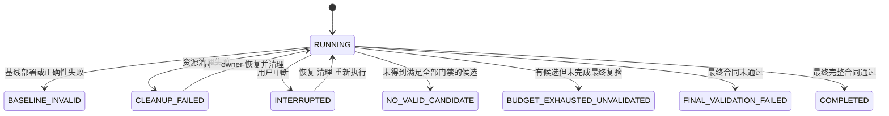

# Architecture

KSEO 的控制器、执行器、验收器和经验检索运行在同一 Python CLI 中。外部 coding Agent 与平台 adapter 是明确的接入点，可以连接现有工具和模型服务。

## 数据与控制路径

TaskSpec 冻结输入、负载、规则和预算。Runner 先建立正确的 baseline，然后让 Optimizer 提出参数或源码候选。候选在 run 内的独立 Git 副本运行，历史源码只读。

Executor 使用 argv 启动用户配置的 adapter，并管理超时、进程组、日志和环境协议。Adapter 执行实际的 SSH、Docker、AIHub、nsys、ncu 或评测脚本，输出逐请求或逐样本原始记录。

Validator 核对实验身份和产物 SHA256，重算 TTFT、TPOT 和精度，再执行当前合同的硬门禁。只有全部通过的有效候选才能更新最佳方案。停止搜索后，在新的 trial 中重新运行完整合同，并导出最佳配置、累计源码补丁和 Manifest。

## 模块边界

| 模块 | 实现位置 | 核心职责 |
| --- | --- | --- |
| CLI 与合同 | `cli.py`、`config.py` | 中文命令入口、草稿拒绝、配置校验 |
| Runner | `runner.py` | 状态、预算、baseline、候选、最终复验和报告 |
| Optimizer | `optimizer.py` | Grid search、外部 Agent 请求与提案约束 |
| Source | `source.py` | 冻结、独立副本、patch 检查和累积导出 |
| Executor | `executor.py` | argv、超时、进程组、日志与残留进程恢复 |
| Validator | `validation.py` | 原始记录重算、身份和硬门禁 |
| Knowledge | `knowledge.py` | 条件检索、事实与假设、待审导入 |
| Resource leases | `locking.py` | 控制器互斥、共享资源租约、失败清理保护 |
| Adapter SDK | `adapter.py` | 为现有脚本生成身份与原始产物协议 |

## 状态和失败类型

trial 还区分 `DEPLOYMENT_FAILED`、`EXECUTION_FAILED`、`INVALID_MEASUREMENT`、`REJECTED_PERFORMANCE`、`REJECTED_VALIDATION`、`VALID_NO_GAIN` 和 `ACCEPTED`。`COMPLETED` 只表示声明类型下的合同通过；synthetic 和 replay 始终不能解释为新的 measured 收益。

## 恢复与可信边界

状态使用临时文件加原子 rename 保存，事件日志追加并 fsync。每个 trial、step 和原始产物单独留档，便于重新验收。控制器完成结果写入但尚未更新 best 时中断，恢复过程会重新执行候选选择。

资源锁与租约分别保存。进程异常退出会释放 OS 文件锁，但未正常结束的租约仍能阻止其他 owner 直接占用同一资源。同一 owner 恢复时先检查本地进程 PID 与 start time，再调用远端幂等 cleanup。共享锁需要可靠支持 flock 与原子 rename 的文件系统，且所有入口使用同一锁目录。

KSEO 不提供网络调度器、OS sandbox、自动发现全部 GPU 使用者或任意模型结构适配。GPU 归属、实际 runtime 核查和远端任务幂等性由 adapter 实现，Agent 的命令权限由宿主环境限制。

最终镜像是否真正固化源码、是否在独立客户端验证、是否使用留出数据以及稳定性持续多久，都必须写进 profile 和 adapter。新的 trial 并不自动等价于新的镜像或新的测试集。
