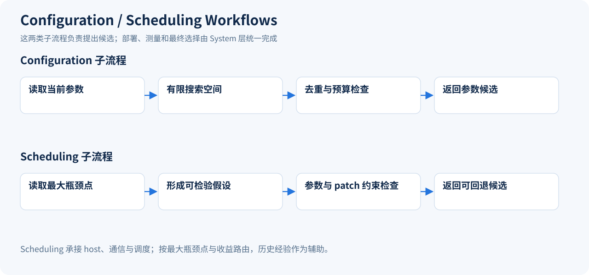
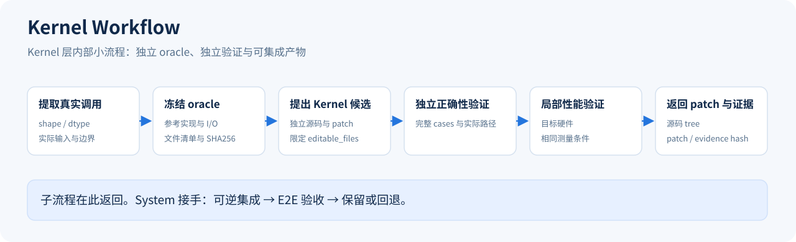

# Architecture

KSEO 按职责分层，并分别展示分层架构、System 大流程和优化子流程。架构图中的箭头只表达层间依赖；流程图中的箭头表达执行顺序。

## 四层职责

| 层次 | 职责 | 对应实现 |
| --- | --- | --- |
| L1 目标与上下文 | 模型、硬件、Workload、能力、目标、质量和预算 | TaskSpec、context、业务 profile |
| L2 System 编排 | 基线、配置优先策略、热点路由、候选集成、E2E 选择和最终交付 | workflows/system.py、workflows/pipeline.py |
| L3 优化子流程 | Configuration、Scheduling、Kernel 分别产生候选和证据 | workflows/configuration.py、scheduling.py、kernel.py |
| L4 共享运行基础 | 执行、隔离源码、独立 Validator、状态、资源、Profile 和经验 | Runner、Executor、Source、Validator、profiling、Knowledge |

Runner 管理一个 trial 的生命周期和可靠执行。System Workflow 决定本轮该运行哪个子流程、如何集成结果及是否继续优化。一个子流程可以包含多个内部阶段，阶段按优化职责组织。

## System 外部大流程

环境和基线通过后，System 使用当前配置与源码的 Profile 选择优化路径。Configuration sweep 先执行，并有独立试验上限；之后按当前热点的类型、占比和可改善空间进入 Scheduling 或 Kernel。

所有候选统一进入隔离源码、部署、测量和完整合同验收。只有全部门禁通过且满足改善要求的候选才能替换 best。接受候选后使用该候选实际采集的 Profile 继续诊断，不能沿用旧配置的热点排名。

热点排序采用 `share × (1 - 1 / achievable_speedup)` 估计可能节省的时间比例。估计值只用于路由和预算；gpu_time 可能含重叠时间，实际端到端收益仍由 E2E 测量判定。

最终复验的预算可以预留。搜索结束时，在新的 trial 中运行完整合同，再输出配置、累积 patch、Manifest、原始证据和中文报告。

## Configuration 与 Scheduling 内部小流程

Configuration 负责有限的 flags、env 和 backend 参数候选，包含去重、失败分类和预算控制。它不自行宣布候选已获性能收益。

Scheduling 接收当前 host、通信或调度热点，由外部 Agent 形成一个可检验假设，返回受参数空间约束的配置或可回退 patch。部署和端到端验证由 System 统一执行。

## Kernel 内部小流程

Kernel Workflow 从选定热点提取实际调用和测试 case，冻结参考实现与 I/O oracle，再让独立 proposer 生成 patch。实际 shape、dtype、stride 和数值边界由目标后端 extractor 负责提供。

局部 validator 在独立源码副本上执行完整 case、数值检查、路径检查和局部性能测试。正确性与局部性能可以由同一个独立 validator 命令依次完成。oracle 的文件集合与 SHA256 在提案和验证后均被重查，修改 oracle 会使候选失效。

patch 只能修改 extractor 声明的 editable_files。局部证据绑定 patch SHA256 与候选源码 tree；System 集成时再次核对，确保被测的局部候选与实际集成内容一致。

局部通过后仅返回候选。Kernel 加速而 E2E 回退时，流程记录 `LOCAL_PASS_E2E_REJECTED`，保留原 best。`kseo validate --trial-dir` 会同时审计 Kernel 独立证据和 E2E 原始结果。

## 参考 GEAK 的流程原则

| GEAK 的设计原则 | KSEO 的整合方式 |
| --- | --- |
| System 层包裹独立 Kernel 工作流 | System Workflow 调用独立 Kernel Workflow，二者有各自阶段与产物 |
| 先尝试成本较低的配置和 backend 调整 | Configuration 有独立预算，先于热点源码工作执行 |
| profiling 与 Amdahl 选择热点 | 使用标准化 Profile，路由至 Scheduling 或 Kernel |
| 抽取独立任务并保持参考 oracle 不变 | extractor、冻结文件清单、独立 validator 和 oracle hash |
| patch 集成后重新检验整体效果 | System 统一 E2E 门禁、best 选择、回退和重采样 |

这些原则参考 [GEAK System Workflow](https://github.com/AMD-AGI/GEAK/tree/main/e2e_workflow) 和 [Kernel Workflow](https://github.com/AMD-AGI/GEAK/tree/main/kernel_workflow)。KSEO 的实现按自身的 Python CLI、现有工具基础和模型经验重新组织；当前没有迁移 GEAK 的 AMD 专用 Kernel、完整角色体系或多 worker 调度器。

任务书、源码、原始实验、社区资料、Profile 和数值测试均可提供输入。历史任务的模型差异和验收经验沉淀为 profile、adapter 与 Knowledge，核心流水线跨模型复用。

## 运行产物和恢复

`workflow-tree.json` 关联 System 试验、子流程及 Kernel 内部阶段。`workflows/` 保存请求、提案、冻结 oracle 和局部结果，`trials/` 保存 E2E 实测与验收，`learned-experience.json` 保存本次实验形成的条件化经验。

待集成提案会持久化，中断后可以继续提交给 System。子流程运行中崩溃时，恢复过程先终止身份匹配的残留本地进程，再调用 cleanup adapter，标记中断阶段并重新调度。所有入口仍需共用资源锁目录与统一 GPU 身份。

外部 Agent 的 OS 权限、真实后端的 GPU 采样和远端任务清理、模型语义适配、最终镜像固化及长期稳定性由对应 adapter 实现。CPU 示例用于验证流水线，不能解释为真实模型的新性能收益。

四张 SVG 的源生成器是 `tools/render_architecture.py`。可通过 `python3 tools/render_architecture.py` 重建，图中不使用跨层回路线。
