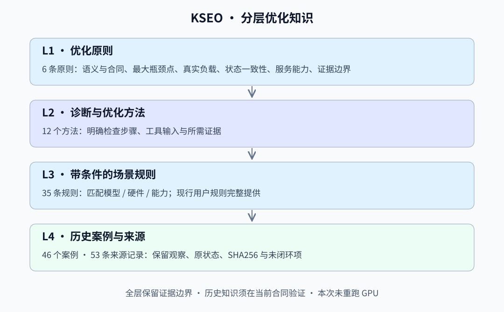

# 分层优化知识

先从原则选择方法，再按当前能力筛选场景规则，最后下钻到历史案例和来源。目录关系用于导航，不把案例归类解释为对父节点全部表述的因果证明。



| 层级 | 内容 | 数量 | 证据边界 |
| --- | --- | --- | --- |
| L1 | 优化原则 | 6 | 跨案例概括，不构成任意模型上的收益证明 |
| L2 | 诊断与优化方法 | 12 | 决定检查和实验步骤，尚需实际工具与证据 |
| L3 | 带条件的场景规则 | 50 | 全模型数学等价/最终精度规则、V4.1 现行规则、跨模型与评测迁移规则 |
| L4 | 历史案例与来源 | 59 | 历史观察与本轮离线数据审计分别记录；均不代表本轮 GPU 实测 |

关联 72 条来源记录，包括历史材料、用户规范和本轮静态数据身份审计。来源记录数不等于独立复现次数。原有 9 张代表性摘要卡未保存逐卡直接来源 hash，明确保留此缺口，不补造引用。

**通用前提 G-P01：速度优化必须数学等价。** 允许的差异限于浮点表示、舍入、等价运算重排或并行归约带来的微小误差，并满足搜索前冻结的容差。数学等价不要求 bitwise 一致；数值接近或质量分数通过也不能单独证明数学等价。该规则对所有模型和优化路径生效，不受 top-k 限制。

**最终精度 G-P02：优化完成后验收 RTLBench、LongBenchv2、LiveCodeBench。** 三项全量与证据有效性均须通过。详见 [最终精度合同与踩坑](final-accuracy.md)。数据按本地冻结集合：RTLBench 160、LongBenchv2 525、LiveCodeBench 400；LongBench 保留 105 条内容各重复 5 次的原顺序和 525 分母，不换官方版本、不去重。

## 组织与证据边界

本批材料抽查 GLM-5.1 NVFP4/FP8、GLM-5.2、V4-Flash 和 V4.1-Flash 的报告、故障分析及部分原始日志。整理前核对新增 23 份原文件的 SHA256；没有逐行审计全部历史日志，没有重跑 GPU，也没有新增真实单机或 P/D 部署 adapter。用户授权整理不提升原证据等级。

| 证据类型 | 可以支持 | 不能直接支持 |
| --- | --- | --- | --- |
| 当前用户规则 | 当前任务应遵守的合同要求 | 功能已经实现、门禁已经执行或通过 |
| 历史实测/正式报告 | 原版本、负载和合同内的观察结果 | 新模型收益、组合变化中单项收益 |
| 原始日志片段 | 该片段内的形状、错误或事件 | 全量请求通过、唯一事故根因 |
| 代码机制审阅 | 可达路径、状态不变量和危险条件 | 未重放请求的输出级因果闭环 |
| 本地/NFS 集成测试报告 | 该测试范围内的隔离或协议行为 | 真实 GPU 性能、长期稳定性 |
| 假设/因果未闭环 | 排查方向和待补证项目 | 已证实根因、无需验证的修复 |

特别保留：R02 组合修复不能拆分收益；R08 未独立重算整份 Nsight SQLite；R13/R14 依据历史代码审阅，未独立重放事故；R15/R20 的输出因果未闭环；R18 是可能缓解，不是根治证明；R19 是本地集成测试报告。

## 按层使用

```bash
# 全目录包含所有条件，仅用于导航
kseo knowledge --tree

# 从原则逐层下钻，也可以直接定位规则或案例
kseo knowledge --node K04
kseo knowledge --node M08
kseo knowledge --node R15
kseo knowledge --node case:R15

# 按模型和明确能力筛选；同时返回祖先、匹配案例和来源
kseo knowledge --hierarchy --context examples/knowledge/glm52-pd-context.json --limit 24
```

`--tree`/`--node` 是完整导航，不隐含条件已满足；不能同时传 `--context`。`--hierarchy` 才筛选条件，缺少能力或硬件字段不假定匹配。示例 context 只演示筛选，不证明该部署已经支持相应能力。

旧 `knowledge --context ...` 继续返回原有平面卡片；新分层接口覆盖本次跨模型规则。`--extra` 只用于旧接口，未审阅导入不会自动进入层级。

外部 Agent 的 `knowledge_hierarchy` 始终带 6 条原则、全模型 G-P01/G-P02 及所选方法、规则、匹配案例、祖先 ID 和来源。`--limit`/top-k 只截断迁移规则；匹配 V4.1 时，11 条模型现行规则完整保留，`model_recipe` 仍完整提供。当前合同和用户规则优先，旧参数、learned-experience 和历史案例不得覆盖；未知阈值仍待确认，不能自动 PASS。

## 原则 → 方法 → 规则

<a id="k01"></a>
### K01 先保证数学等价、模型语义与合同可比

速度优化必须在数学上等价，只允许浮点表示和运算自身带来的微小数值差异；先验证模型能力、结构和参考，再冻结质量与协议合同。

<a id="m01"></a>
#### M01 能力矩阵、结构适配与冻结参考

1. 核对 architecture×GPU×attention×dtype×backend/version×TP/PP/MTP。
2. 先独立修正结构与参考，再冻结 baseline/oracle；用真实路径 smoke 确认可用。

所需证据：实际模型 config/权重/forward；backend 与 runtime 指纹；正确参考与版本。

场景规则：[R05](knowledge.md#r05) 功能开关不代表可用，先建立精确 backend 能力矩阵、[R10](knowledge.md#r10) 模型结构性适配先于性能，IndexShare 的复用范围必须明确、[B09](knowledge.md#b09) LiveCodeBench 仅加载冻结 release，不引入无关版本依赖。

<a id="m02"></a>
#### M02 数学等价、数值误差与质量合同

1. 先说明数学变换如何等价，区分浮点微小误差与算法/模型语义变化；在搜索前冻结 dtype、误差口径和容差。
2. 冻结 thinking、输出预算、retry、scorer 与总分母。
3. 从现行合同生成门禁；数值 oracle、条件 Feature 与已退役的文本相似度门禁分别处理。

所需证据：数学等价性说明与独立数值 oracle；不可变 dtype/容差/质量合同；逐样本终态与计分理由。

场景规则：[R16](knowledge.md#r16) Thinking 模式与输出预算是质量合同，不能把截断直接归因数值精度、[G-P01](knowledge.md#g-p01) 速度优化必须数学等价，只允许浮点自身引入的微小差异、[B04](knowledge.md#b04) RTLBench 编译/仿真显式 fail-closed、[B06](knowledge.md#b06) RTL 提取按目标模块完整边界，不从首个 endmodule 截断、[B07](knowledge.md#b07) LiveCodeBench 统一提取最终代码并全量离线重评、[B08](knowledge.md#b08) LiveCodeBench 文本/二进制 I/O 共用状态，错误哨兵不能按真值计分、[B10](knowledge.md#b10) LongBenchv2 只从最终正文提取 A-D，非空无选项按错计分、[B11](knowledge.md#b11) Thinking、输出预算和重试规则在生成前冻结、[V41-P05](knowledge.md#v41-p05) Feature 选择首个 MoE Layer 的下一层输入、[V41-P06](knowledge.md#v41-p06) 不以模型输出文本相似度作为验收门禁。

<a id="k02"></a>
### K02 围绕最大瓶颈点和 E2E 收益优化

按因果关键路径、可改善空间和测量噪声分配预算；micro 收益须通过完整请求验证。

<a id="m03"></a>
#### M03 拆因果关键路径与真实 P/D 路由

1. 按请求和 token ordinal 关联事件，区分就绪等待、计算、传输、同步。
2. 核对时钟和 profiler 开销；P/D 逐请求证明 Router→P→connector→D。

所需证据：trace 关联键/时钟范围；非采样正式计时；KV 传输和加载证据。

场景规则：[R07](knowledge.md#r07) NCCL/recv 很长可能是等待，最大瓶颈应按依赖关键路径定位、[R08](knowledge.md#r08) Profiler 的关联键、时钟和正式计时必须分清、[R09](knowledge.md#r09) P/D 必须证明真实路由，并分解 KV 传输/激活至首 token 的开销。

<a id="m04"></a>
#### M04 估计收益上界并决定分支止损

1. 将 Amdahl/逐 shape oracle 上界与 E2E 方差、目标差距和实现成本比较。
2. 收益不足则归档停止；集成后重验并保留可回退基线。

所需证据：上界估算假设；重复测量与噪声；分支决策记录。

场景规则：[R06](knowledge.md#r06) 先比较可实现收益上界、测量噪声和目标差距，再投入深度调优。

<a id="k03"></a>
### K03 覆盖真实负载、执行阶段和资源边界

真实 shape、冷路径、Prefill/Decode、Graph 与内存峰值共同决定可用性；平均改善不能掩盖合同内回退。

<a id="m05"></a>
#### M05 生产 shape、阶段 dispatch 与单 shape warmup

1. 从真实 trace 提取 shape/dtype/stride/tail、阶段和分布。
2. 按有效合同固定缓存政策、唯一 warmup 与请求顺序，检查各长度和 C1→C4 曲线。

所需证据：shape 分布与 dispatch；forward ledger；逐 shape/并发 TTFT 与 TPOT。

场景规则：[R01](knowledge.md#r01) 按真实生产 shape 分布调优，不能只优化一个 micro case、[R04](knowledge.md#r04) Prefill 与 Decode 的 kernel 参数需要分阶段选择、[V41-P01](knowledge.md#v41-p01) 正式速度开启 Prefix Cache，首 token 隔离并实证零命中、[V41-P02](knowledge.md#v41-p02) 只 Warmup 一个声明的 shape，检查其他 shape 的真实收益、[V41-P03](knowledge.md#v41-p03) 较短输入的 TTFT 不应反向超过较长输入、[V41-P04](knowledge.md#v41-p04) 检查 C1 到 C4 的 TTFT/TPOT 是否突增。

<a id="m06"></a>
#### M06 峰值显存与 Graph 双路径验收

1. 核算权重、KV、临时 workspace、activation、Graph 与 allocator 峰值。
2. 分别验证 capture、replay、eager 与最大上下文/并发，保留安全余量。

所需证据：峰值分配/释放轨迹；Graph 与非 Graph 结果；容量和性能复验。

场景规则：[R02](knowledge.md#r02) 显存预算同时覆盖 KV 与临时 workspace，KV 预留不是越大越好、[R03](knowledge.md#r03) CUDA Graph capture 与正常执行是两条都要验证的路径。

<a id="k04"></a>
### K04 维护请求与跨阶段状态的一致性

区分有效内容、计算进度、已验证 token 和返回状态；复用前证明状态及 KV 轨迹兼容。

<a id="m07"></a>
#### M07 投机解码与远端 KV 的状态机验证

1. 定义 KV 就绪、token 追加、verify/correction 和返回的状态转移。
2. 按 request+ordinal/step 检查跨 PP 一致性，并覆盖长输出、拒绝回退和请求加入/退出。

所需证据：跨阶段状态 trace；target verification 与 acceptance；生命周期回归。

场景规则：[R11](knowledge.md#r11) 远端 KV 首 token 状态与 MTP draft 启动必须分开处理、[R12](knowledge.md#r12) MTP 通过短 smoke 不代表长输出生命周期正确、[R13](knowledge.md#r13) 同请求同 token ordinal 的 accepted-count/correction 在 PP stage 间须一致。

<a id="m08"></a>
#### M08 可复用 Batch/KV 的有效边界与来源隔离

1. 分离内容有效 span、计算进度和 speculative span；检查 move/condense/换请求。
2. KV 复用记录 producer provenance；区分 real/pad query 并逐层证明输出因果。

所需证据：row/request 映射和有效长度；KV producer/runtime 指纹；real/pad 与输出反事实。

场景规则：[R14](knowledge.md#r14) persistent row 的有效内容长度不能被 chunk 计算进度覆盖、[R15](knowledge.md#r15) 跨 Prefill producer 的 KV 复用必须先证明轨迹可互换、[R20](knowledge.md#r20) 越界风险要检查真实请求边界；输出根因还须追到真实 query/采样行。

<a id="k05"></a>
### K05 把 API、观测、准入和稳定性作为交付能力

吞吐与延迟之外，还要检查真实 metrics、usage、预算、终态释放、协议及持续服务行为。

<a id="m09"></a>
#### M09 API 对账、预算与一次 admission

1. 用真实 tokenizer/processor 验证消息对象边界；对账 metrics 与 usage。
2. 输入长度、有效输出预算先算后预留；重试需当前合同允许，终态先停上游再释放一次。

所需证据：API 输入/输出与真实计数；reservation/attempt 账本；取消与失败路径。

场景规则：[R17](knowledge.md#r17) 工具消息必须覆盖 tokenizer 的真实对象/序列化边界、[R18](knowledge.md#r18) 多模态 cache 同步错误若重试，必须有界且保持一次 admission、[V41-P07](knowledge.md#v41-p07) 对外暴露等价的 /metrics 和 /v1/metrics、[V41-P08](knowledge.md#v41-p08) Messages usage 四字段与缓存命中率必须口径一致、[V41-P09](knowledge.md#v41-p09) Router 拒绝超长输入，裁剪可容纳输入的输出预算、[V41-P10](knowledge.md#v41-p10) 按全局请求数/token 总量限流，不增加图片尺寸或格式限制。

<a id="m10"></a>
#### M10 稳定性回放与精确服务生命周期

1. 按当前合同冻结 1200 纯文本；具备图文能力时额外冻结 1200 随机插图样本。
2. Backend adapter 用 run/trial 与平台服务身份隔离日志、PID、admission 和 stop 产物。

所需证据：冻结样本/随机种子/图片身份；逐请求终态；平台身份与精确清理证据。

场景规则：[R19](knowledge.md#r19) 部署产物必须按精确服务身份隔离，不能共用 PID/日志/停止标记、[V41-P11](knowledge.md#v41-p11) 必须回放 1200 纯文本，图文模型另回放 1200 随机插图样本。

<a id="k06"></a>
### K06 让证据可追溯，让结论停在证据边界

来源、身份、合同和阶段随结论保存；部署失败、无效测量、性能回退、机制分析和已证实根因分别记录。

<a id="m11"></a>
#### M11 身份、合同版本、候选阶段与最终复验

1. 将源码、镜像、runtime、负载和合同绑定到每份结果。
2. 缺少或不匹配身份时拒绝进入正式比较；候选 PASS 与最终镜像复验分别记录。

所需证据：身份 Manifest；阶段与合同版本；最终产物的新 trial 结果。

场景规则：[E01](knowledge.md#e01) 运行身份与计时口径不匹配时，正式比较无效、[E02](knowledge.md#e02) 候选通过后仍需最终不可变产物复验、[B01](knowledge.md#b01) 全量验收核对内容身份，不能只核对 ID 数量、[B02](knowledge.md#b02) 最终精度保持最佳优化产物与服务行为一致、[B03](knowledge.md#b03) 子进程必须使用冻结评测器，prediction 不能替代原始账本、[B13](knowledge.md#b13) 数值达线、基准有效性与完整交付分别判定、[G-P02](knowledge.md#g-p02) 优化完成后进行 RTLBench、LongBenchv2、LiveCodeBench 最终精度验收。

<a id="m12"></a>
#### M12 失败分型与因果证据审查

1. 先区分 unsupported、部署失败、无效测量、有效回退和质量失败。
2. 把危险前置条件、状态污染、真实采样和输出异常分层证明；缺失 raw 与未闭环项明确列出。

所需证据：失败阶段/类别；正反例与未排除因素；因果链和待补证清单。

场景规则：[E03](knowledge.md#e03) 加载或环境失败不作为有效性能负分、[E04](knowledge.md#e04) 事故假设必须与机制证明和输出根因分开、[B05](knowledge.md#b05) RTLBench 冻结原 testbench，基准争议不能靠自建 oracle 消除、[B12](knowledge.md#b12) 编译器、glibc、上下文和工具失败先归类为环境/协议问题。

## 场景规则细目

G-P01 是本轮明确补充的全模型前提。V4.1 原规则完整内容见模型 recipe；本表不重写它的阈值、停用项或计数语义。

<a id="b01"></a>
### B01 全量验收核对内容身份，不能只核对 ID 数量

上层方法：[M11](knowledge.md#m11)。

适用条件：final_accuracy。

类别：**需要当前任务验证的迁移规则**。冻结数据版本、原文件 hash、顺序和 ID，同时核对去掉 ID 后的内容身份；本地快照、官方版本、裁剪子集和重复扩增分别命名；当前任务按用户指定的本地集合验收，不替换或去重。

证据基础：CURRENT_OFFLINE_DATA_AUDIT。

- 边界：历史 317/525 只绑定原本地语料与当时合同，不能替代新模型实测或声称官方全量；重复性质作为证据边界披露，不改变本地验收分母。
- 边界：本轮未重新请求模型或执行全部历史编译/仿真/代码测试；历史分数不属于 KSEO 新实测。

下钻案例：[case:B01](knowledge-cases.md#case-b01)。

<a id="b02"></a>
### B02 最终精度保持最佳优化产物与服务行为一致

上层方法：[M11](knowledge.md#m11)。

适用条件：final_accuracy。

类别：**需要当前任务验证的迁移规则**。最终三项测试使用最终源码、镜像、配置、拓扑及明确的采样/Thinking/上下文协议；需要调整评测协议时冻结新版本并保留可比 baseline。

证据基础：HISTORICAL_CONTRACT_AND_REPORT。

- 边界：具体 TP/PP、Max、High、预算及阈值均属于原合同，不能自动继承。
- 边界：本轮未重新请求模型或执行全部历史编译/仿真/代码测试；历史分数不属于 KSEO 新实测。

下钻案例：[case:B02](knowledge-cases.md#case-b02)。

<a id="b03"></a>
### B03 子进程必须使用冻结评测器，prediction 不能替代原始账本

上层方法：[M11](knowledge.md#m11)。

适用条件：final_accuracy。

类别：**需要当前任务验证的迁移规则**。核对所有 worker 的真实 import 路径、evaluator/提取器 hash，并逐样本绑定完整 prompt、raw attempt 与所计分的 final_content；缺失历史 raw 不补造。

证据基础：HISTORICAL_INCIDENT_REPORT。

- 边界：本轮未重演该故障；缺失 raw 不能由后续正常 run 或 summary 事后重建。
- 边界：本轮未重新请求模型或执行全部历史编译/仿真/代码测试；历史分数不属于 KSEO 新实测。

下钻案例：[case:B03](knowledge-cases.md#case-b03)。

<a id="b04"></a>
### B04 RTLBench 编译/仿真显式 fail-closed

上层方法：[M02](knowledge.md#m02)。

适用条件：final_accuracy。

类别：**需要当前任务验证的迁移规则**。同时核对编译退出码、仿真退出码、成功/失败标记及逐测试终态；没有异常文本或进程退出 0 不能单独判通过。

证据基础：HISTORICAL_REVIEW。

- 边界：这些是原 harness 的缺陷，不意味着所有测试失败都是模型错误。
- 边界：本轮未重新请求模型或执行全部历史编译/仿真/代码测试；历史分数不属于 KSEO 新实测。

下钻案例：[case:B04](knowledge-cases.md#case-b04)。

<a id="b05"></a>
### B05 RTLBench 冻结原 testbench，基准争议不能靠自建 oracle 消除

上层方法：[M12](knowledge.md#m12)。

适用条件：final_accuracy。

类别：**需要当前任务验证的迁移规则**。模型回答、提取产物、原 testbench、执行环境和规则逐项 hash 绑定；发现矛盾时记录归因和有效性缺口，不自行补期望输出、删题或以目标分数调规则。

证据基础：HISTORICAL_REVIEW_WITH_EXPLICIT_ACCEPTANCE_BOUNDARY。

- 边界：旧任务对精确版本的用户接受不授权新任务修改 TB，也不认证旧基准所有语义。
- 边界：本轮未重新请求模型或执行全部历史编译/仿真/代码测试；历史分数不属于 KSEO 新实测。

下钻案例：[case:B05](knowledge-cases.md#case-b05)。

<a id="b06"></a>
### B06 RTL 提取按目标模块完整边界，不从首个 endmodule 截断

上层方法：[M02](knowledge.md#m02)。

适用条件：final_accuracy。

类别：**需要当前任务验证的迁移规则**。冻结确定性的目标模块提取规则，处理前缀、重复目标与辅助模块依赖；保留原正文、提取前后 diff 和全体样本，不能按仿真输赢挑选提取版本。

证据基础：HISTORICAL_EXTRACTION_AUDIT。

- 边界：特定旧提取器规则不是适用于所有语言/模块结构的通用 parser；本轮未重新编译。
- 边界：本轮未重新请求模型或执行全部历史编译/仿真/代码测试；历史分数不属于 KSEO 新实测。

下钻案例：[case:B06](knowledge-cases.md#case-b06)。

<a id="b07"></a>
### B07 LiveCodeBench 统一提取最终代码并全量离线重评

上层方法：[M02](knowledge.md#m02)。

适用条件：final_accuracy。

类别：**需要当前任务验证的迁移规则**。只按预先冻结、确定性的 code-generation 规则处理 final_content；修 parser 后在相同完整数据和原测试上统一重评，不只替换失败题，不改正文或测试。

证据基础：HISTORICAL_FULL_RESCORING_REPORT。

- 边界：“最后代码块”是当时版本规则，不能按样本输赢选择 first/last/longest；单题诊断不等于全量成绩。
- 边界：本轮未重新请求模型或执行全部历史编译/仿真/代码测试；历史分数不属于 KSEO 新实测。

下钻案例：[case:B07](knowledge-cases.md#case-b07)。

<a id="b08"></a>
### B08 LiveCodeBench 文本/二进制 I/O 共用状态，错误哨兵不能按真值计分

上层方法：[M02](knowledge.md#m02)。

适用条件：final_accuracy。

类别：**需要当前任务验证的迁移规则**。预检 input/print、stdin.buffer/stdout.buffer、混合读写共享游标；-1/-2 均为错误状态，禁止 all([-1,-2]) 一类 fail-open。

证据基础：HISTORICAL_PREFLIGHT_AND_RESCORING_REPORT。

- 边界：兼容层不得改题意、输入、expected output 或测试规则；预检 PASS 不是模型精度 PASS。
- 边界：本轮未重新请求模型或执行全部历史编译/仿真/代码测试；历史分数不属于 KSEO 新实测。

下钻案例：[case:B08](knowledge-cases.md#case-b08)。

<a id="b09"></a>
### B09 LiveCodeBench 仅加载冻结 release，不引入无关版本依赖

上层方法：[M01](knowledge.md#m01)。

适用条件：final_accuracy。

类别：**需要当前任务验证的迁移规则**。固定 release_v1 的 400 题及原顺序/测试 payload；加载器按版本先选择文件，再下载，不能漂移至 v2..v6。

证据基础：HISTORICAL_LOADER_INCIDENT。

- 边界：该结论仅描述旧加载器；加载失败不是模型精度或 release_v1 不可用的结论。
- 边界：本轮未重新请求模型或执行全部历史编译/仿真/代码测试；历史分数不属于 KSEO 新实测。

下钻案例：[case:B09](knowledge-cases.md#case-b09)。

<a id="b10"></a>
### B10 LongBenchv2 只从最终正文提取 A-D，非空无选项按错计分

上层方法：[M02](knowledge.md#m02)。

适用条件：final_accuracy。

类别：**需要当前任务验证的迁移规则**。冻结答案 parser，只读取 final_content；显式区分无有效选项、不可解析、传输失败，全部留在总分母，不因非空无选项重采样。

证据基础：HISTORICAL_SCORING_WITH_CURRENT_SCOPE_CORRECTION。

- 边界：不得从 reasoning 中挑选对的选项；原 51.43% 线不是当前默认门槛。
- 边界：本轮未重新请求模型或执行全部历史编译/仿真/代码测试；历史分数不属于 KSEO 新实测。

下钻案例：[case:B10](knowledge-cases.md#case-b10)。

<a id="b11"></a>
### B11 Thinking、输出预算和重试规则在生成前冻结

上层方法：[M02](knowledge.md#m02)。

适用条件：final_accuracy。

类别：**需要当前任务验证的迁移规则**。每套正式数据统一模型行为与预算策略，逐 attempt 留痕；仅允许合同事先授权的重试条件，非空正常回答不因低分重采样，失败和空正文保留分母。

证据基础：HISTORICAL_CONTRACTS_WITH_VERSION_BOUNDARY。

- 边界：上述具体预算和两次请求只作为历史实例；新任务必须自己声明并冻结。
- 边界：本轮未重新请求模型或执行全部历史编译/仿真/代码测试；历史分数不属于 KSEO 新实测。

下钻案例：[case:B11](knowledge-cases.md#case-b11)。

<a id="b12"></a>
### B12 编译器、glibc、上下文和工具失败先归类为环境/协议问题

上层方法：[M12](knowledge.md#m12)。

适用条件：final_accuracy。

类别：**需要当前任务验证的迁移规则**。对齐编译器、仿真器、Python/依赖及容器身份，保留工具错误；上下文资源不足不能静默换配置或删长题后继续同一正式验收。

证据基础：HISTORICAL_ENVIRONMENT_REPORT。

- 边界：不是说所有 0 分都属于环境问题；每次归因需实际错误和原样本证据。
- 边界：本轮未重新请求模型或执行全部历史编译/仿真/代码测试；历史分数不属于 KSEO 新实测。

下钻案例：[case:B12](knowledge-cases.md#case-b12)。

<a id="b13"></a>
### B13 数值达线、基准有效性与完整交付分别判定

上层方法：[M11](knowledge.md#m11)。

适用条件：final_accuracy。

类别：**需要当前任务验证的迁移规则**。将所选 run、数据、代码、提取器、测试、逐题结果和明确用户决定绑定；单项分数/联合均分达线不能覆盖 raw、材料来源和运行记录缺口。

证据基础：HISTORICAL_ACCEPTANCE_AUDIT。

- 边界：单次历史用户接受只对精确产物和合同生效，不是通用豁免。
- 边界：本轮未重新请求模型或执行全部历史编译/仿真/代码测试；历史分数不属于 KSEO 新实测。

下钻案例：[case:B13](knowledge-cases.md#case-b13)。

<a id="e01"></a>
### E01 运行身份与计时口径不匹配时，正式比较无效

上层方法：[M11](knowledge.md#m11)。

适用条件：通用检查；不含新模型的数值默认或通过承诺。

类别：**需要当前任务验证的迁移规则**。max_num_seqs、拓扑、源码、镜像、负载及计时口径都属于结果身份；未知字段保留证据不足，不能补成默认通过。

证据基础：LEGACY_SUMMARIES_AND_V41_HISTORICAL_RECORDS。

- 边界：概括层不能证明任意模型、GPU 或版本已有收益。
- 边界：案例归类用于导航，不能把所有子案例视为对父节点每个子句的独立证明。
- 边界：所引原有 C 系列摘要无逐卡直接文件 hash；具体历史状态与缺口须下钻案例。

下钻案例：[C05](knowledge-cases.md#c05)、[V41-H05](knowledge-cases.md#v41-h05)。

<a id="e02"></a>
### E02 候选通过后仍需最终不可变产物复验

上层方法：[M11](knowledge.md#m11)。

适用条件：通用检查；不含新模型的数值默认或通过承诺。

类别：**需要当前任务验证的迁移规则**。记录 stage 与 contract_version；最终镜像/runtime、完整 speed/API/稳定性必须按有效合同另行验收，不能由候选 PASS 代替。

证据基础：LEGACY_SUMMARIES_AND_V41_HISTORICAL_RECORDS。

- 边界：概括层不能证明任意模型、GPU 或版本已有收益。
- 边界：案例归类用于导航，不能把所有子案例视为对父节点每个子句的独立证明。
- 边界：所引原有 C 系列摘要无逐卡直接文件 hash；具体历史状态与缺口须下钻案例。

下钻案例：[C08](knowledge-cases.md#c08)、[V41-H10](knowledge-cases.md#v41-h10)。

<a id="e03"></a>
### E03 加载或环境失败不作为有效性能负分

上层方法：[M12](knowledge.md#m12)。

适用条件：通用检查；不含新模型的数值默认或通过承诺。

类别：**需要当前任务验证的迁移规则**。按实际失败阶段归档 deployment/unsupported/invalid/performance；先消除拓扑污染与依赖问题，再讨论性能胜负。

证据基础：LEGACY_SUMMARIES_AND_V41_HISTORICAL_RECORDS。

- 边界：概括层不能证明任意模型、GPU 或版本已有收益。
- 边界：案例归类用于导航，不能把所有子案例视为对父节点每个子句的独立证明。
- 边界：所引原有 C 系列摘要无逐卡直接文件 hash；具体历史状态与缺口须下钻案例。

下钻案例：[C06](knowledge-cases.md#c06)、[V41-H13](knowledge-cases.md#v41-h13)。

<a id="e04"></a>
### E04 事故假设必须与机制证明和输出根因分开

上层方法：[M12](knowledge.md#m12)。

适用条件：通用检查；不含新模型的数值默认或通过承诺。

类别：**需要当前任务验证的迁移规则**。精确实例日志、状态污染路径和输出级反事实缺失时保留假设状态，不把怀疑对象写成所有事故的已证实根因。

证据基础：LEGACY_SUMMARY_HYPOTHESIS_ONLY。

- 边界：原 C09 是初步怀疑，缺少直接事故实例证据和逐卡原文件 SHA256；只能指导排查，不能认定根因。

下钻案例：[C09](knowledge-cases.md#c09)。

<a id="g-p01"></a>
### G-P01 速度优化必须数学等价，只允许浮点自身引入的微小差异

上层方法：[M02](knowledge.md#m02)。

适用条件：通用检查；不含新模型的数值默认或通过承诺。

类别：**全模型通用的当前用户规则**。规则不是已经执行的真实模型验收证据。

- 所有模型及 Configuration、Scheduling、Kernel、P/D、cache 路径的速度优化均须保持原计算的数学定义；给出变换与原 forward 的等价性说明。
- 数学等价不要求浮点 bitwise 一致；误差须能解释为浮点表示、舍入、运算顺序或并行归约造成的微小差异。
- 冻结 dtype、参考实现、真实 shape/stride/mask/position、误差统计与容差，再执行独立数值 oracle；未知容差不得猜测统一常数或自动判 PASS。
- 不得以更高速度或质量分数通过为由采用非等价近似、跳过必要计算/target verification、删减真实 token、改变 mask/position/KV 语义或暗改精度合同。
- 数值接近不单独证明数学等价，有限样本 oracle 通过不构成全域证明；数学依据、数值误差与有效合同的 E2E 门禁都要检查。
- 本规则不重新启用模型输出文本相似度门禁，也不要求采样文本逐字一致；Feature 仅在当前合同启用时按对应选层规则执行。

完整规则：`kseo knowledge --node G-P01`；各项具体证据及实现边界见 policy。当前规则不重新启用已退役的输出文本相似度门禁。

证据基础：CURRENT_USER_POLICY。

- 边界：这是必须遵守的规范，不代表 KSEO 已自动证明任意候选数学等价。
- 边界：数值 oracle 或质量分数通过不能代替数学等价性依据；本轮没有 GPU 复测。

下钻案例：规则声明；无独立经验案例。

<a id="g-p02"></a>
### G-P02 优化完成后进行 RTLBench、LongBenchv2、LiveCodeBench 最终精度验收

上层方法：[M11](knowledge.md#m11)。

适用条件：通用检查；不含新模型的数值默认或通过承诺。

类别：**全模型通用的当前用户规则**。规则不是已经执行的真实模型验收证据。

- System 完成速度优化和最佳产物复验后，以同一最终产物依次执行 RTLBench、LongBenchv2、LiveCodeBench 全量精度；不能用 GSM8K 替代。
- 先冻结数据版本、完整样本/内容身份、prompt、Thinking、预算、重试、parser、evaluator 和数值门槛，缺失时保持未验收。
- 真实 measured 合同必须配置 final_accuracy；三个数据集均从 raw attempt 与逐样本结果独立重算，并检查有效性审阅。
- 当前数据入口以本地冻结集合为准：RTLBench 160、LongBenchv2 525、LCB release_v1 400；LongBench 的 525 条对应 105 条内容各重复 5 次，保留原顺序和 525 分母，不能换官方版本或自行去重。
- 遵守 B01-B13 的失败分类、冻结 oracle、统一重评和来源边界；旧任务预算、得分和用户接受不自动迁移。

完整规则：`kseo knowledge --node G-P02`；各项具体证据及实现边界见 policy。当前规则不重新启用已退役的输出文本相似度门禁。

证据基础：CURRENT_USER_POLICY。

- 边界：规则和接口已建立不代表三项真实模型测试已经运行；本轮未启动模型或占用 GPU。

下钻案例：规则声明；无独立经验案例。

<a id="r01"></a>
### R01 按真实生产 shape 分布调优，不能只优化一个 micro case

上层方法：[M05](knowledge.md#m05)。

适用条件：通用检查；不含新模型的数值默认或通过承诺。

类别：**需要当前任务验证的迁移规则**。先从真实 trace 提取 M/N、dtype、stride、tail、请求与阶段分布；在该分布和真实 E2E 上比较。保留小/大 shape 的 dispatch 边界，不用单一合成 shape 的提升决定集成。

证据基础：历史实测/正式报告。

- 边界：具体 tile、group 阈值和 shape 清单只适用于原模型/版本，不做新模型默认。
- 边界：本次仅整理历史知识，未重跑 GPU；迁移建议须在当前合同和实际 runtime 上验证。

下钻案例：[case:R01](knowledge-cases.md#case-r01)。

<a id="r02"></a>
### R02 显存预算同时覆盖 KV 与临时 workspace，KV 预留不是越大越好

上层方法：[M06](knowledge.md#m06)。

适用条件：通用检查；不含新模型的数值默认或通过承诺。

类别：**需要当前任务验证的迁移规则**。按峰值核算权重、KV、logits/indices、activation、graph 与 allocator 缓存；稀疏结构优先按实际 nnz 紧凑存储，并在满足目标上下文/并发后给 workspace 留余量。

证据基础：历史实测/正式报告。

- 边界：不能从组合修复推导某个固定 KV GB 数的单项收益，也不能把首个 warmup 与 hot 请求做直接速度比。
- 边界：本次仅整理历史知识，未重跑 GPU；迁移建议须在当前合同和实际 runtime 上验证。

下钻案例：[case:R02](knowledge-cases.md#case-r02)。

<a id="r03"></a>
### R03 CUDA Graph capture 与正常执行是两条都要验证的路径

上层方法：[M06](knowledge.md#m06)。

适用条件：cuda_graph。

类别：**需要当前任务验证的迁移规则**。对动态标量读取、分配、地址/shape 依赖逐项审查 capture-safe 条件。分别测试 capture、replay、非 graph 与最大内存路径，不以 eager 的正确性替代 graph 验收。

证据基础：历史实测/正式报告。

- 边界：旧修复的 dense-width fallback 不是所有新模型的默认；仍要防止该 fallback 造成 OOM。
- 边界：本次仅整理历史知识，未重跑 GPU；迁移建议须在当前合同和实际 runtime 上验证。

下钻案例：[case:R03](knowledge-cases.md#case-r03)。

<a id="r04"></a>
### R04 Prefill 与 Decode 的 kernel 参数需要分阶段选择

上层方法：[M05](knowledge.md#m05)。

适用条件：sparse_attention。

类别：**需要当前任务验证的迁移规则**。调度参数、split-KV、tile、workspace 与 backend dispatch 以真实执行阶段和 shape 为条件；每个阶段独立验证后再测完整请求。

证据基础：历史实测/正式报告。

- 边界：不能把 split-KV、特定 block size 或 eager/graph 的胜负推广到所有模型。
- 边界：本次仅整理历史知识，未重跑 GPU；迁移建议须在当前合同和实际 runtime 上验证。

下钻案例：[case:R04](knowledge-cases.md#case-r04)。

<a id="r05"></a>
### R05 功能开关不代表可用，先建立精确 backend 能力矩阵

上层方法：[M01](knowledge.md#m01)。

适用条件：通用检查；不含新模型的数值默认或通过承诺。

类别：**需要当前任务验证的迁移规则**。在启动前核对 模型结构×GPU 架构×attention 类型×dtype×backend/version×TP/PP/MTP 的组合，并用实际路径 smoke 证明。Unsupported 与性能不佳分别记录。

证据基础：历史实测/正式报告。

- 边界：仅证明当时版本的 GLM 路径不支持，不意味着所有 SM80 模型均不支持 FP8 KV。
- 边界：本次仅整理历史知识，未重跑 GPU；迁移建议须在当前合同和实际 runtime 上验证。

下钻案例：[case:R05](knowledge-cases.md#case-r05)。

<a id="r06"></a>
### R06 先比较可实现收益上界、测量噪声和目标差距，再投入深度调优

上层方法：[M04](knowledge.md#m04)。

适用条件：通用检查；不含新模型的数值默认或通过承诺。

类别：**需要当前任务验证的迁移规则**。把理论或 oracle 上界与真实关键路径、试验方差、剩余目标差距一起评估；收益不足时归档并结束分支，不为微小局部数值持续扩张实现复杂度。

证据基础：历史实测/正式报告。

- 边界：不能把所有 kernel 都设置相同毫秒阈值；噪声与收益下限取当前合同和重复测量。
- 边界：本次仅整理历史知识，未重跑 GPU；迁移建议须在当前合同和实际 runtime 上验证。

下钻案例：[case:R06](knowledge-cases.md#case-r06)。

<a id="r07"></a>
### R07 NCCL/recv 很长可能是等待，最大瓶颈应按依赖关键路径定位

上层方法：[M03](knowledge.md#m03)。

适用条件：pp。

类别：**需要当前任务验证的迁移规则**。把源端发出、目标端就绪、实际传输、计算和同步等待拆开；只有改变关键依赖链的候选才预期产生 E2E 收益，不把长 recv 或 cudaGraphLaunch 全算成网络带宽/Python 开销。

证据基础：历史实测/正式报告。

- 边界：该结论不否认真实网络瓶颈；需按当前拓扑重新分解。
- 边界：本次仅整理历史知识，未重跑 GPU；迁移建议须在当前合同和实际 runtime 上验证。

下钻案例：[case:R07](knowledge-cases.md#case-r07)。

<a id="r08"></a>
### R08 Profiler 的关联键、时钟和正式计时必须分清

上层方法：[M03](knowledge.md#m03)。

适用条件：通用检查；不含新模型的数值默认或通过承诺。

类别：**需要当前任务验证的迁移规则**。用进程/设备/相关 ID 和请求 ordinal 关联事件；无统一时钟时用因果顺序和同机区间。Profile 用来归因，正式性能用同合同的非采样测量。

证据基础：历史实测/正式报告。

- 边界：未独立重算整份 Nsight SQLite；本轮核对的是原报告的方法与结果。
- 边界：本次仅整理历史知识，未重跑 GPU；迁移建议须在当前合同和实际 runtime 上验证。

下钻案例：[case:R08](knowledge-cases.md#case-r08)。

<a id="r09"></a>
### R09 P/D 必须证明真实路由，并分解 KV 传输/激活至首 token 的开销

上层方法：[M03](knowledge.md#m03)。

适用条件：pd_disaggregation。

类别：**需要当前任务验证的迁移规则**。逐请求串起 Router→P→KV connector→D，保存 KV 参数/传输与实际加载证据；拆分 prefill、remote KV 等待/激活、first decode。不能仅凭 endpoint 可用或网卡有流量认定 P/D 有效或高速。

证据基础：历史实测/正式报告。

- 边界：decode_first interval 含多种开销，不能把整个区间都称为纯网线传输；链路吞吐不能从配置带宽推算。
- 边界：本次仅整理历史知识，未重跑 GPU；迁移建议须在当前合同和实际 runtime 上验证。

下钻案例：[case:R09](knowledge-cases.md#case-r09)、[C07](knowledge-cases.md#c07)。

<a id="r10"></a>
### R10 模型结构性适配先于性能，IndexShare 的复用范围必须明确

上层方法：[M01](knowledge.md#m01)。

适用条件：index_share。

类别：**需要当前任务验证的迁移规则**。从实际 config/权重/forward 确认哪些层计算、哪些层共享，并绑定请求、层、step 和缓冲区生命周期。先把结构正确性修复作为单独 baseline 版本，再冻结 oracle，不能在优化中悄悄替换参考。

证据基础：历史实测/正式报告。

- 边界：仅用于有对应能力的模型；联合 RDMA+IndexShare+MTP 结果不能分摊为单项收益。
- 边界：本次仅整理历史知识，未重跑 GPU；迁移建议须在当前合同和实际 runtime 上验证。

下钻案例：[case:R10](knowledge-cases.md#case-r10)、[C02](knowledge-cases.md#c02)。

<a id="r11"></a>
### R11 远端 KV 首 token 状态与 MTP draft 启动必须分开处理

上层方法：[M07](knowledge.md#m07)。

适用条件：pd_disaggregation；mtp；pp。

类别：**需要当前任务验证的迁移规则**。显式定义 KV 就绪、token 已追加、token 已验证、token 已返回等状态，用正确阶段控制首 draft。同步测 TTFT、TPOT 和 acceptance，避免以减少首 token 延迟破坏后续投机协议。

证据基础：历史实测/正式报告。

- 边界：output_len<=1 是当时实现的修复条件，不作为所有框架的通用代码。
- 边界：本次仅整理历史知识，未重跑 GPU；迁移建议须在当前合同和实际 runtime 上验证。

下钻案例：[case:R11](knowledge-cases.md#case-r11)。

<a id="r12"></a>
### R12 MTP 通过短 smoke 不代表长输出生命周期正确

上层方法：[M07](knowledge.md#m07)。

适用条件：mtp。

类别：**需要当前任务验证的迁移规则**。把多轮 draft/verify、拒绝回退、长输出、请求完成/释放、并发与新请求加入作为完整用例；不能在 1–4 token smoke 后直接宣布支持 PP+MTP。

证据基础：历史实测/正式报告。

- 边界：这些是当时候选的失败，不代表后续版本或该算法永远不可用。
- 边界：本次仅整理历史知识，未重跑 GPU；迁移建议须在当前合同和实际 runtime 上验证。

下钻案例：[case:R12](knowledge-cases.md#case-r12)、[C01](knowledge-cases.md#c01)、[V41-H09](knowledge-cases.md#v41-h09)。

<a id="r13"></a>
### R13 同请求同 token ordinal 的 accepted-count/correction 在 PP stage 间须一致

上层方法：[M07](knowledge.md#m07)。

适用条件：pp；mtp；async_scheduling。

类别：**需要当前任务验证的迁移规则**。用 request_id+token ordinal/step_id 比较各 stage 的 verifier 结果、correction、position 和 KV cursor；覆盖部分接受、拒绝、async 延迟和状态复用。不要比较不同墙钟时刻的 rank 瞬时值来误判。

证据基础：历史代码因果审阅；未独立重跑。

- 边界：本轮依据报告中的代码因果分析，没有独立重放全部历史字符损坏请求；不把它写成所有事故的唯一根因。
- 边界：本次仅整理历史知识，未重跑 GPU；迁移建议须在当前合同和实际 runtime 上验证。

下钻案例：[case:R13](knowledge-cases.md#case-r13)。

<a id="r14"></a>
### R14 persistent row 的有效内容长度不能被 chunk 计算进度覆盖

上层方法：[M08](knowledge.md#m08)。

适用条件：persistent_batch；chunked_prefill。

类别：**需要当前任务验证的迁移规则**。为有效内容、已计算进度、speculative span 分别定义字段；同请求未完成内容不得因局部进度被缩短。搬行必须复制有效 span 并同步 request 映射；换请求时重新初始化生命周期。

证据基础：历史代码机制审阅；未独立重跑。

- 边界：不是要求所有长度都单调增加：MTP rollback 和请求结束/重分配有不同语义，不能一律使用 max() 掩盖问题。
- 边界：本次仅整理历史知识，未重跑 GPU；迁移建议须在当前合同和实际 runtime 上验证。

下钻案例：[case:R14](knowledge-cases.md#case-r14)。

<a id="r15"></a>
### R15 跨 Prefill producer 的 KV 复用必须先证明轨迹可互换

上层方法：[M08](knowledge.md#m08)。

适用条件：multi_prefill_producer；pd_disaggregation；prefix_cache。

类别：**需要当前任务验证的迁移规则**。给 KV identity 记录 producer/runtime/config provenance；未证明可互换前隔离或保持 producer affinity。验证 Same/Cross、cold/warm、prefix/suffix 指纹和最终输出。

证据基础：机制报告支持；输出因果尚未完全闭环。

- 边界：确认的是危险混合状态，不把所有字符损坏归因于它；输出闭环仍待补证。
- 边界：不要求用 cache_salt 实现，也不改变现行正式零命中测速无 salt 的规则。
- 边界：本次仅整理历史知识，未重跑 GPU；迁移建议须在当前合同和实际 runtime 上验证。

下钻案例：[case:R15](knowledge-cases.md#case-r15)。

<a id="r16"></a>
### R16 Thinking 模式与输出预算是质量合同，不能把截断直接归因数值精度

上层方法：[M02](knowledge.md#m02)。

适用条件：thinking。

类别：**需要当前任务验证的迁移规则**。冻结 thinking、generation budget、retry 与 scorer；区分 transport、reasoning 截断、不可解析和答错，失败保留在总分母。修正合同后新测，不拼接补测或只报可解析子集。

证据基础：历史实测/正式报告。

- 边界：不自动把 768 或 128K 当新模型默认，也不因该原因豁免质量门禁。
- 边界：本次仅整理历史知识，未重跑 GPU；迁移建议须在当前合同和实际 runtime 上验证。

下钻案例：[case:R16](knowledge-cases.md#case-r16)、[V41-H08](knowledge-cases.md#v41-h08)。

<a id="r17"></a>
### R17 工具消息必须覆盖 tokenizer 的真实对象/序列化边界

上层方法：[M09](knowledge.md#m09)。

适用条件：tools。

类别：**需要当前任务验证的迁移规则**。对 text、tool definitions/history、多模态混合请求验证真实 tokenizer/processor 调用，明确各边界的输入类型和规范化方式；schema 能解析不等于可以 deepcopy/pickle 或编码。

证据基础：历史实测/正式报告。

- 边界：plain dict 是当时修复，不要求所有类型无条件转 dict；必须保留原协议语义。
- 边界：本次仅整理历史知识，未重跑 GPU；迁移建议须在当前合同和实际 runtime 上验证。

下钻案例：[case:R17](knowledge-cases.md#case-r17)。

<a id="r18"></a>
### R18 多模态 cache 同步错误若重试，必须有界且保持一次 admission

上层方法：[M09](knowledge.md#m09)。

适用条件：multimodal；pp。

类别：**需要当前任务验证的迁移规则**。仅在当前合同允许且明确识别为可重试错误、尚未向客户端发送输出时有界重试；一个外部请求只有一次 reservation，每次 attempt 单独可追踪。不能对所有 500 盲重试、重复发送流或隐藏首次失败。

证据基础：历史实测/正式报告。

- 边界：一次重试成功只能证明缓解可能，不能声称根治 multimodal cache 同步；禁止把无重试合同静默改成有重试。
- 边界：本次仅整理历史知识，未重跑 GPU；迁移建议须在当前合同和实际 runtime 上验证。

下钻案例：[case:R18](knowledge-cases.md#case-r18)。

<a id="r19"></a>
### R19 部署产物必须按精确服务身份隔离，不能共用 PID/日志/停止标记

上层方法：[M10](knowledge.md#m10)。

适用条件：shared_storage。

类别：**需要当前任务验证的迁移规则**。真实 Backend adapter 使用 run/trial+平台 training/Pod 身份隔离所有可变产物，启动映射原子发布；stop/snapshot 必须验证精确身份，失败清理不能误用另一个服务的文件。

证据基础：历史 NFS 集成与单测报告。

- 边界：报告中的模拟 training ID 不是新真实模型实测；本轮没有执行部署或停止任务。
- 边界：本次仅整理历史知识，未重跑 GPU；迁移建议须在当前合同和实际 runtime 上验证。

下钻案例：[case:R19](knowledge-cases.md#case-r19)。

<a id="r20"></a>
### R20 越界风险要检查真实请求边界；输出根因还须追到真实 query/采样行

上层方法：[M08](knowledge.md#m08)。

适用条件：sparse_attention。

类别：**需要当前任务验证的迁移规则**。边界检查使用请求有效 seq_len/num_blocks，probe 分离 real/pad query、KV 写入与最终 logits_indices。把危险前置条件、真实状态污染、输出异常分层证明，不从 padding 行最大值跳到串话根因。

证据基础：边界机制代码审阅；输出因果未闭环。

- 边界：修复危险边界不等于已经证明历史输出根因；原审阅也说明部分事故 raw 不可访问。
- 边界：本次仅整理历史知识，未重跑 GPU；迁移建议须在当前合同和实际 runtime 上验证。

下钻案例：[case:R20](knowledge-cases.md#case-r20)、[V41-H12](knowledge-cases.md#v41-h12)。

<a id="v41-p01"></a>
### V41-P01 正式速度开启 Prefix Cache，首 token 隔离并实证零命中

上层方法：[M05](knowledge.md#m05)。

适用条件：model_family=deepseek_v4_1（含明确别名）。

类别：**当前用户规则**；具体操作、待确认参数和 adapter 要求以 `kseo recipe deepseek-v4.1-flash` 为准。

- 冻结原始 prompt、chat template、输出长度、提交顺序和实际 tokenizer/processor 身份。
- 只在测试端替换第一个用户内容 token；验证完整 rendered token IDs 仅一处改变，位置位于首个 cache block。
- 验证替换前后实际 token 总数相同，同批首个 cache block 身份互异；跨批复用同一变体时按合同 reset 并保存证据。
- 核对实际服务 Prefix Cache 已开启、请求无 cache_salt 或等价 namespace 注入，逐请求记录 cache read=0。
- 不得仅凭字符不同、token ID 不同或 reset 返回成功就认定零命中。
- 256K 等长度先核对真实输入、模板与输出预算不超过上下文容量；不支持时记录 BLOCKED，不截断、漏测或伪称通过。

完整解释：[V4.1-Flash 专项经验](models/deepseek-v4.1-flash.md)。

证据基础：CURRENT_USER_POLICY。

- 边界：未补齐的阈值和实际后端证据不能视为验收通过。
- 边界：规则声明不代表对应真实 adapter 已实现或验收已通过。

下钻案例：[V41-H06](knowledge-cases.md#v41-h06)。

<a id="v41-p02"></a>
### V41-P02 只 Warmup 一个声明的 shape，检查其他 shape 的真实收益

上层方法：[M05](knowledge.md#m05)。

适用条件：model_family=deepseek_v4_1（含明确别名）。

类别：**当前用户规则**；具体操作、待确认参数和 adapter 要求以 `kseo recipe deepseek-v4.1-flash` 为准。

- 在运行前声明唯一 model-forward warmup 的 shape、参数和位置，冻结基线/候选请求顺序。
- 触发 forward 的 smoke、maxlen/vision 检查和 profiler dry-run 也必须计入，或安排在正式计时之后。
- 不得通过对评测中的每个 shape 各自预热来掩盖 JIT、lazy initialization、autotune 或图/metadata 状态开销。
- 逐个比较非 warmup shape 与可比 Baseline；每个都须满足当前合同声明的收益条件，不能由总平均改善代替。
- 记录所有 rank 的 JIT/首次路径和请求历史；Prefix Cache reset 不代表运行时状态清空。

完整解释：[V4.1-Flash 专项经验](models/deepseek-v4.1-flash.md)。

证据基础：CURRENT_USER_POLICY。

- 边界：未补齐的阈值和实际后端证据不能视为验收通过。
- 边界：规则声明不代表对应真实 adapter 已实现或验收已通过。

下钻案例：[C04](knowledge-cases.md#c04)、[V41-H01](knowledge-cases.md#v41-h01)、[V41-H02](knowledge-cases.md#v41-h02)、[V41-H03](knowledge-cases.md#v41-h03)。

<a id="v41-p03"></a>
### V41-P03 较短输入的 TTFT 不应反向超过较长输入

上层方法：[M05](knowledge.md#m05)。

适用条件：model_family=deepseek_v4_1（含明确别名）。

类别：**当前用户规则**；具体操作、待确认参数和 adapter 要求以 `kseo recipe deepseek-v4.1-flash` 为准。

- 按实际 tokenizer 长度分组，同长度不强排顺序。
- 保留全部样本和反向对；相同 warmup、cache 与提交顺序下对照 Baseline。
- 2048 的比较方向、允许容差和计时口径明确后才能生成自动门禁；不继承历史 4096/0.100s 或 4096/0.800s 作为本次默认。
- 服务端计时缺失时标记证据不足，不估算或用客户端时间替代。

完整解释：[V4.1-Flash 专项经验](models/deepseek-v4.1-flash.md)。

证据基础：CURRENT_USER_POLICY。

- 边界：未补齐的阈值和实际后端证据不能视为验收通过。
- 边界：规则声明不代表对应真实 adapter 已实现或验收已通过。

下钻案例：[V41-H04](knowledge-cases.md#v41-h04)。

<a id="v41-p04"></a>
### V41-P04 检查 C1 到 C4 的 TTFT/TPOT 是否突增

上层方法：[M05](knowledge.md#m05)。

适用条件：model_family=deepseek_v4_1（含明确别名）。

类别：**当前用户规则**；具体操作、待确认参数和 adapter 要求以 `kseo recipe deepseek-v4.1-flash` 为准。

- 固定输入与输出 token 数、服务配置、缓存策略和提交方式。
- 同时保留逐请求、mean、max/p95 及相邻并发档增长率；改善的单一档位不能替代整条曲线。
- 突增时检查 active request set、prefill/decode phase、同步、PP 传输、排队、KV 与内存压力。
- 未提供缓慢增长的数值阈值时列为诊断项，不能编造倍率、仅因微小非单调变化拒绝，或宣称已通过平滑性硬门禁。

完整解释：[V4.1-Flash 专项经验](models/deepseek-v4.1-flash.md)。

证据基础：CURRENT_USER_POLICY。

- 边界：未补齐的阈值和实际后端证据不能视为验收通过。
- 边界：规则声明不代表对应真实 adapter 已实现或验收已通过。

下钻案例：[C03](knowledge-cases.md#c03)、[V41-H07](knowledge-cases.md#v41-h07)。

<a id="v41-p05"></a>
### V41-P05 Feature 选择首个 MoE Layer 的下一层输入

上层方法：[M02](knowledge.md#m02)。

适用条件：model_family=deepseek_v4_1（含明确别名）。

类别：**当前用户规则**；具体操作、待确认参数和 adapter 要求以 `kseo recipe deepseek-v4.1-flash` 为准。

- 从实际模型结构与 forward 路径定位第一个包含 MoE 的 Layer，保存模块路径证据。
- 不要把 VL wrapper、PP rank-local 层号或经验中的 Layer_1 字符串当成通用规则。
- 冻结 input/output、pre/post-norm、dtype、采样位置与 reference 身份；候选和 Baseline 完全一致。
- 首个 MoE 不存在、下一层不存在或 hook 无法证明时 BLOCKED，不悄悄改选其他张量。
- 相似度阈值和重复次数取当前合同；不把历史 0.99 或最大 3x3 比较自动提升为新默认。

完整解释：[V4.1-Flash 专项经验](models/deepseek-v4.1-flash.md)。

证据基础：CURRENT_USER_POLICY。

- 边界：未补齐的阈值和实际后端证据不能视为验收通过。
- 边界：规则声明不代表对应真实 adapter 已实现或验收已通过。

下钻案例：规则声明；无独立经验案例。

<a id="v41-p06"></a>
### V41-P06 不以模型输出文本相似度作为验收门禁

上层方法：[M02](knowledge.md#m02)。

适用条件：model_family=deepseek_v4_1（含明确别名）。

类别：**当前用户规则**；具体操作、待确认参数和 adapter 要求以 `kseo recipe deepseek-v4.1-flash` 为准。

- 不要求输出文本相似度，不把空字符串直接计为相似度零而拒绝候选。
- 不得把这个规则扩展为停用 Feature、GSM8K、算子/reference、API 语义或请求完成性验收。
- 区分 final content 为空但 reasoning/tool 输出有效，与整个流均无有效生成内容。后者仍按业务/协议门禁处理。
- 保留实际 token、finish reason、失败和不可解析样本；HTTP200 或 completion_tokens 非零不能单独证明有效响应。

完整解释：[V4.1-Flash 专项经验](models/deepseek-v4.1-flash.md)。

证据基础：CURRENT_USER_POLICY。

- 边界：未补齐的阈值和实际后端证据不能视为验收通过。
- 边界：规则声明不代表对应真实 adapter 已实现或验收已通过。

下钻案例：[V41-H11](knowledge-cases.md#v41-h11)。

<a id="v41-p07"></a>
### V41-P07 对外暴露等价的 /metrics 和 /v1/metrics

上层方法：[M09](knowledge.md#m09)。

适用条件：model_family=deepseek_v4_1（含明确别名）。

类别：**当前用户规则**；具体操作、待确认参数和 adapter 要求以 `kseo recipe deepseek-v4.1-flash` 为准。

- 从对外 endpoint 分别访问两个路径，确认状态、格式、鉴权和指标语义等价；动态采样值允许随时间变化，不要求字节完全相同。
- 冻结指标名称、类型、labels、单位及采样口径；Running/Waiting 是实际推理请求状态，不是平台 training 状态。
- TTFT 与 decode latency 记录真实样本，load 后 histogram count 应增加，Running 在负载中可观测为正，Waiting 即使为零也不能缺失。
- 历史 vLLM 暴露 inter-token latency/ITL，若映射为 TPOT 必须说明是否与逐请求 (total_ms-ttft_ms)/(output_tokens-1) 等价；不能只改名称。
- upstream metrics 失败应如实返回明确错误，不以空文本 HTTP200 伪造健康指标。

完整解释：[V4.1-Flash 专项经验](models/deepseek-v4.1-flash.md)。

证据基础：CURRENT_USER_POLICY。

- 边界：未补齐的阈值和实际后端证据不能视为验收通过。
- 边界：规则声明不代表对应真实 adapter 已实现或验收已通过。

下钻案例：[V41-H17](knowledge-cases.md#v41-h17)。

<a id="v41-p08"></a>
### V41-P08 Messages usage 四字段与缓存命中率必须口径一致

上层方法：[M09](knowledge.md#m09)。

适用条件：model_family=deepseek_v4_1（含明确别名）。

类别：**当前用户规则**；具体操作、待确认参数和 adapter 要求以 `kseo recipe deepseek-v4.1-flash` 为准。

- 四项均为非 boolean 的非负整数，0 <= cache_read <= 实际完整 prompt tokens；与原生 tokenizer/template/tools/vision 展开计数一致。
- 本 V4.1 历史合同 input 已含未命中输入，creation 是独立报告项，不能再次相加或扣减而重复计数。其他后端若采用三段互斥计费，必须显式声明另一合同，不静默混用。
- 流式 message_start/message_delta 等携带 usage 的事件与最终汇总语义一致；非流式同样校验，不能丢掉累计 cache 字段。
- 以 cold/warm/reset-control、同图和不同图的真实请求核对 usage 与服务端缓存计数；缺少真实 cache read 证据时标为无法验收。
- 正式速度零命中与功能 warm-cache 正命中分别验收，不能用固定四个数字冒充正确。

完整解释：[V4.1-Flash 专项经验](models/deepseek-v4.1-flash.md)。

证据基础：CURRENT_USER_POLICY。

- 边界：未补齐的阈值和实际后端证据不能视为验收通过。
- 边界：规则声明不代表对应真实 adapter 已实现或验收已通过。

下钻案例：[V41-H15](knowledge-cases.md#v41-h15)。

<a id="v41-p09"></a>
### V41-P09 Router 拒绝超长输入，裁剪可容纳输入的输出预算

上层方法：[M09](knowledge.md#m09)。

适用条件：model_family=deepseek_v4_1（含明确别名）。

类别：**当前用户规则**；具体操作、待确认参数和 adapter 要求以 `kseo recipe deepseek-v4.1-flash` 为准。

- 先解析与实际计数，再做上下文校验/输出裁剪，最后用裁剪后预算做 admission reservation。
- 输入已超过最大上下文时在模型 forward/入队前拒绝，返回实际值、最大值与明确错误。
- 输入可容纳但总预算越界时保留完整输入，将输出上限缩至剩余空间并正常调用上游；不能将它误判为输入过长或限流。
- 覆盖小于、等于、大于最大上下文，以及输入可容纳时 input+output 等于和大于边界；保存实际发往上游的 effective_max_tokens。

完整解释：[V4.1-Flash 专项经验](models/deepseek-v4.1-flash.md)。

证据基础：CURRENT_USER_POLICY。

- 边界：未补齐的阈值和实际后端证据不能视为验收通过。
- 边界：规则声明不代表对应真实 adapter 已实现或验收已通过。

下钻案例：规则声明；无独立经验案例。

<a id="v41-p10"></a>
### V41-P10 按全局请求数/token 总量限流，不增加图片尺寸或格式限制

上层方法：[M09](knowledge.md#m09)。

适用条件：model_family=deepseek_v4_1（含明确别名）。

类别：**当前用户规则**；具体操作、待确认参数和 adapter 要求以 `kseo recipe deepseek-v4.1-flash` 为准。

- 所有推理 endpoint 共用 admission 账本，统计已接纳且未完成的 running+waiting；health/metrics scrape 不占推理名额。
- 按真实完整输入与裁剪后输出预算预留 token；缓存命中的输入仍计入，支持多候选时按实际最大占用预留。
- 原子地检查请求数和聚合 token 两个上限；上限与拒绝状态码取当前合同，不自动复制历史 16 请求/4M token 默认。
- 正常、错误、timeout、断连、取消、网关异常均需先终止/关闭上游，再恰好释放一次；拒绝请求不分配也不 release。
- 不限制单张图片高、宽、像素数，不额外设置格式白名单；合法且运行时可解码/处理的图片走原生 processor 并按真实视觉 token 计入上下文和限流。
- 损坏 base64、无法解码或协议非法仍返回真实输入错误；模型确实不支持的能力须明确报告，不能伪装成自设图片尺寸/格式限流。
- 不继承旧的 1920x1080、2,073,600 像素、10 张图片等为现行默认；不为通过测试而丢图、私自缩图、替换图片或降低输入语义。

完整解释：[V4.1-Flash 专项经验](models/deepseek-v4.1-flash.md)。

证据基础：CURRENT_USER_POLICY。

- 边界：未补齐的阈值和实际后端证据不能视为验收通过。
- 边界：规则声明不代表对应真实 adapter 已实现或验收已通过。

下钻案例：[V41-H14](knowledge-cases.md#v41-h14)、[V41-H16](knowledge-cases.md#v41-h16)。

<a id="v41-p11"></a>
### V41-P11 必须回放 1200 纯文本，图文模型另回放 1200 随机插图样本

上层方法：[M10](knowledge.md#m10)。

适用条件：model_family=deepseek_v4_1（含明确别名）。

类别：**当前用户规则**；具体操作、待确认参数和 adapter 要求以 `kseo recipe deepseek-v4.1-flash` 为准。

- 冻结完整 1200 条纯文本 source_id、顺序、请求内容、负载 SHA256 和首轮尝试；不得只跑子集或以少量 smoke 替代。
- 具备图文能力时再执行完整 1200 条图文回放；可基于同一 1200 文本 source_id 随机插图，以保留配对关系。
- 测试前声明随机图片数的分布/范围与 seed，冻结每条样本的图片数量、图片 SHA256、顺序、格式及实际尺寸；基线/候选复用同一 manifest。
- 图文回放每条至少包含一张有效图片，并证明实际进入 vision processor/encoder 路径；随机图片数的测试范围不是 API 人为限制。
- 在 P10 不新增尺寸、像素和格式限制的前提下使用真实图片；完整 token 计数、上下文和 admission 仍按 P08-P10 处理。
- 分别报告两轮的成功/失败、错误类别、有效生成、timeout、崩溃/重启、延迟和 admission 释放情况；失败保留在分母，重试单列不能覆盖首次结果。
- 回放并发、成功率、时限与其他稳定性门槛须由当前合同明确；执行完 1200 条不能自动宣布稳定性 PASS。
- 纯文本模型可凭实际能力证据将图文轮标记 NOT_APPLICABLE；本条不要求额外第三轮，也不复制旧任务的样本阈值为默认。

完整解释：[V4.1-Flash 专项经验](models/deepseek-v4.1-flash.md)。

证据基础：CURRENT_USER_POLICY。

- 边界：未补齐的阈值和实际后端证据不能视为验收通过。
- 边界：规则声明不代表对应真实 adapter 已实现或验收已通过。

下钻案例：规则声明；无独立经验案例。

## 能力标签

`context.capabilities` 是显式筛选标签；声明不等于后端已支持或验收已通过。下表列出本批跨模型规则使用的标签，原模型 recipe 另有 `mhc`、`kv_offloading` 等能力。没有提供标签时，对应专门规则不会进入自动检索。

| 标签 | 含义 |
| --- | --- |
| `cuda_graph` | 实际运行启用 CUDA Graph |
| `sparse_attention` | 实际注意力路径为稀疏实现 |
| `pp` | 实际部署为多 PP stage |
| `pd_disaggregation` | 当前任务配置为 P/D；真实路由仍须按 R09 验收 |
| `index_share` | 模型结构具备 IndexShare |
| `mtp` | 实际启用 MTP/speculative decoding |
| `async_scheduling` | 实际启用异步调度 |
| `persistent_batch` | 复用 persistent batch row |
| `chunked_prefill` | 实际启用 chunked prefill |
| `multi_prefill_producer` | 存在多个 Prefill producer |
| `prefix_cache` | 实际启用 Prefix Cache |
| `thinking` | 具有并启用相应 Thinking 路径 |
| `tools` | 对外提供工具消息协议 |
| `multimodal` | 实际支持多模态路径 |
| `shared_storage` | 部署可变产物使用共享存储 |
| `final_accuracy` | 当前任务已声明最终三项精度验收；不代表评测已通过 |

案例筛选只判断索引已声明的模型/硬件/能力字段。本批新案例未完整结构化原 GPU、backend commit、拓扑与全部负载，因此同模型案例被返回只表示相关，完整迁移资格仍须通过 M01 能力与身份核对。

## 数据与维护

主体是 `src/kseo/data/knowledge-hierarchy.json`，最终精度经验位于 `experience-final-accuracy.json`；现有规则/卡片通过 `legacy_links` 引用原始 recipe。层级加载检查 ID、连续层级、引用闭合与证据边界；来源使用 `cross:`/`v41:`/`accuracy:` 命名空间。

公开来源只保留相对实验路径或文件名、行号（本批来源）、SHA256 和审阅范围。原文件未随仓库公开，无法只靠 hash 在公开环境复算历史结果。证据不足项必须补齐后另建结论，不能回写历史失败为通过。

```bash
# 改动数据后重建本手册、案例页和层级图
PYTHONPATH=src python3 tools/render_knowledge.py
```

[完整案例与来源索引](knowledge-cases.md) · [经验转换](conversion.md) · [Agent 接口](agent-workflow.md)
