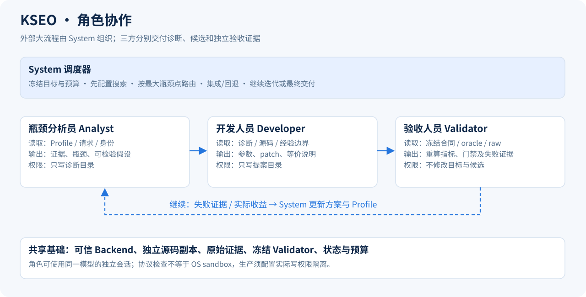

# 瓶颈分析、开发与独立验收

KSEO 用三个职责角色和一个 System 调度器组织闭环。角色不限定模型厂商，也不要求三个不同的 LLM；生产运行应分开会话、目录和写权限。当前 analyst、developer 可接外部 coding Agent，验收的最终裁决由冻结的程序化 Validator 执行。



| 角色 | 读取什么 | 交付什么 | 权限边界 |
| --- | --- | --- | --- |
| 瓶颈分析员 Analyst | 当前 Profile、模型/硬件 context、runtime、请求目录、源码/参数身份、历史失败、目标与预算 | 最大瓶颈点、证据引用、单个可检验假设、Scheduling/Kernel 建议；配置搜索由 System 先执行 | 只写诊断目录，不改源码、证据、合同和 Validator |
| 开发人员 Developer | 已选瓶颈、经验边界、只读源码、允许参数空间 | 完整参数、patch、数学等价说明、浮点差异说明 | 只写提案目录，不改参考实现、测试集、门禁和验收结果 |
| 验收人员 Validator | 冻结合同/oracle、本地固定数据、候选身份、可信 adapter 的原始结果 | 独立重算指标、逐项门禁、局部与端到端结论、失败证据 | 不修候选、不放宽容差、不删失败样本、不改分母 |
| System | 三方产物、阶段目标、剩余预算 | 路由、隔离集成、保留/回退、下一轮、最终交付状态 | 不修改冻结目标；未达目标或未通过最终验收不能结束为成功 |

Configuration 先进行有预算上限的配置搜索。后续根据最大瓶颈点及可验证的收益选择 Scheduling 或 Kernel。每轮只检验一个假设；实际收益由 E2E 请求测量决定，Amdahl 仅作为排序估计。

开发请求的 `knowledge_hierarchy.optimization_methods` 提供 M13 总则及17个方向导航。先由当前成本证据选择方向，再下钻条件、唯一动作、控制与反证；目录不会自动安装外部 skill，也不证明后端已支持。GPU 内线程/CTA 流水线仍进入 Kernel 的独立验证；host 调度或模型生命周期按实际边界进入 Scheduling。详见 [优化思路与方向](optimization-methods.md)。

## 已接入的协议

执行 `kseo roles` 查看机器可读的输入、输出和权限约定。pipeline 可以配置可选分析员：

```json
{
  "optimizer": {
    "kind": "pipeline",
    "analyst": {"command": ["/path/to/analyst-wrapper"], "timeout_seconds": 600},
    "require_equivalence_rationale": true
  }
}
```

分析命令读取 `KSEO_ANALYST_REQUEST`，向 `KSEO_ANALYST_OUTPUT` 写：

```json
{
  "schema_version": 1,
  "input_sha256": "与本轮 request 一致的摘要",
  "ranked_hypotheses": [{
    "hotspot_id": "本轮 Profile 已有的热点 ID",
    "lane": "scheduling",
    "evidence": ["对应 trace、请求时间线或 Profile 项的引用"],
    "hypothesis": "只改一个机制后，预计哪个时间段减少，并如何证伪"
  }]
}
```

System 校验输入摘要、热点 ID、路径类型和证据字段，再检查配置支持、已尝试记录、可编辑性及最低预期收益。分析员不能通过自行写一个更大的“收益数字”绕过这些限制。引用的因果解释仍需后续实验验证；格式校验不能证明解释真实。未配置 analyst 时使用现有 Profile/Amdahl 规则路由，报告中不会把它称为 LLM 分析员。

开发命令沿用 `KSEO_AGENT_REQUEST` / `KSEO_AGENT_PROPOSAL`。request 含 `role_contract`。启用 `require_equivalence_rationale` 时，提案还必须含：

```json
{
  "equivalence": {
    "statement": "说明变换前后的数学关系及成立条件",
    "floating_point_notes": "说明舍入、归约次序等差异及冻结容差；无变化也明确说明"
  }
}
```

这两段是待独立审查的依据。KSEO 不把自然语言说明当成数学证明，也不声称有限样本能证明所有输入都等价。Kernel 的 extractor 冻结真实调用、参考实现和 cases；独立 validator 检查执行路径、数值和局部性能。通过后，System 在新源码副本集成同一 patch，再执行 E2E 验证。

## 验收与反馈

开发人员的“PASS”没有裁决权。Validator 校验源码、镜像、参数、数据、请求数量、缓存和计时语义，从原始逐请求/逐题记录重算指标。可信的实际采集器和 evaluator 是前提；KSEO 不能仅凭文件声明证明远端运行真实发生。

搜索阶段允许保留正确且更好的中间候选，标记 `SEARCH_CORRECTNESS_AND_PROGRESS`，不会将尚未达到最终速度线的 best 称为最终成功。最终复验使用新部署实例，执行完整速度、多轮（若要求）、GSM8K、API、稳定性，以及 RTLBench → LongBenchv2 → LiveCodeBench。

失败返回具体类别：诊断无效、提案无效、部署/执行失败、数值不通过、性能回退、最终精度不通过、目标未达。System 保留原始证据和当前最佳有效候选，下一轮使用对应反馈。历史成功与当前合同不符时，只能作为经验。

可以另接独立 Agent 审阅数学依据、测试有效性和未覆盖风险，但当前没有内置通用 reviewer LLM；硬门禁失败不能由审阅意见覆盖。协议限制、源码摘要和工具冻结是完整性检查，**不是 OS sandbox**。同一个具备全部写权限的进程仍可能破坏隔离，部署环境须实际限制文件与凭据访问。
